# Onboarding do Sistema de Controle de Estoque Clinico

Guia operacional completo para uso do sistema local da Dra. Ana Morong.

Este documento foi escrito para orientar uma pessoa nova no sistema, do primeiro acesso ate os fluxos completos de agenda, estoque, aplicacoes, relatorios, etiquetas, QR Code, camera, e-mails, auditoria e backup.

> Observacao sobre prints: este arquivo nao inclui prints automaticos porque as telas podem conter dados clinicos, pacientes, e saldos reais. Ao preparar uma versao impressa ou de treinamento, use a secao "Checklist de prints recomendados" no final e insira imagens reais capturadas com dados autorizados.

---

## 1. Visao geral

O sistema e um aplicativo desktop Tauri + React + TypeScript com banco SQLite local. Isso significa que os dados principais ficam no computador da clinica, nao em um servidor externo. O app organiza a rotina clinica em torno de quatro pilares:

1. Pacientes e prontuarios.
2. Protocolos, agendamentos e aplicacoes.
3. Estoque, lotes, locais, etiquetas e rastreabilidade.
4. Relatorios, auditoria, backup e integracoes externas.

O fluxo mais importante e:

```mermaid
flowchart LR
  A["Cadastrar ou revisar estoque"] --> B["Cadastrar protocolos clinicos"]
  B --> C["Cadastrar paciente"]
  C --> D["Planejar aplicacao no prontuario"]
  D --> E["Agendar aplicacao"]
  E --> F["Executar aplicacao"]
  F --> G["Selecionar area, itens e lotes"]
  G --> H["Finalizar e baixar estoque"]
  H --> I["Gerar evolucao, relatorios e rastreabilidade"]
```



Regra de ouro:

- Planejar ou agendar nao baixa estoque.
- A baixa de estoque acontece ao finalizar a aplicacao/procedimento.
- Correcoes posteriores sao registradas com auditoria e movimentos de correcao.
- Backups devem ser usados antes de qualquer operacao de risco, como restauracao ou importacao em massa.

---

## 2. Menu lateral e mapa de telas

O sistema usa um menu lateral fixo. As telas principais sao:

| Menu | Caminho interno | Para que serve |
| --- | --- | --- |
| Dashboard | `/dashboard` | Visao geral da operacao, KPIs, graficos, alertas e acoes rapidas. |
| Agenda | `/agenda` | Criar, editar, confirmar, cancelar e executar agendamentos. |
| Pacientes | `/patients` | Cadastro, busca, status, prontuario e historico clinico. |
| Aplicacoes | `/procedures` | Lista de atendimentos/aplicacoes e criacao de aplicacao avulsa. |
| Protocolos | `/protocols` | Cadastro de protocolos clinicos, itens padrao e modelos de evolucao. |
| Estoque | `/inventory` | Lista geral de itens, saldo, lote, validade, entrada, ajuste e administracao. |
| Medicamentos | `/medications` | Lista tipada apenas de medicamentos. |
| Materiais | `/materials` | Lista tipada apenas de materiais clinicos e descartaveis. |
| Equipamentos | `/equipment` | Lista tipada de equipamentos e acessorios. |
| Etiquetas | `/labels` | Gerar etiquetas, imprimir, calibrar folha, consultar QR Code e usar camera. |
| Relatorios | `/reports` | Central de documentos clinicos, estoque, rastreabilidade e auditoria. |
| Auditoria | `/audit` | Logs de acoes, usuarios, entidades alteradas e detalhes antes/depois. |
| Configuracoes | `/settings` | Preferencias da clinica, estoque, Apps Script, leitor de camera e onboarding. |
| Backup | `/backup` | Ver caminho do banco, exportar backup e restaurar backup. |

Rotas complementares importantes:

| Tela | Caminho interno | Quando aparece |
| --- | --- | --- |
| Prontuario do paciente | `/patients/{patientId}` | Ao clicar em um paciente. |
| Nova aplicacao avulsa | `/procedures/new` | Botao "Nova Aplicacao". |
| Executar aplicacao planejada | `/procedures/execute/{applicationPlanId}` | Ao iniciar uma aplicacao agendada/planejada. |
| Nova entrada de estoque | `/inventory/entry` | Ao receber itens ou importar XML. |
| Novo item | `/inventory/items/new` | Ao criar medicamento, material, equipamento ou outro item. |
| Editar item | `/inventory/items/{itemId}/edit` | Ao editar cadastro de um item existente. |
| Financeiro do estoque | `/inventory/financial` | Analise de valor parado, consumo e perdas. |
| Fornecedores | `/inventory/suppliers` | Biblioteca de fornecedores. |
| Locais e armarios | `/inventory/locations` | Cadastro de locais fisicos de armazenamento. |
| Lista de compras | `/reports/purchase-plan` | Sugestao de reposicao. |
| Importacao/exportacao CSV | `/settings/import-export` | Importar/exportar dados locais em CSV. |

---

## 3. Conceitos principais

Antes de operar, e importante entender os nomes usados pelo sistema.

### Paciente

Cadastro da pessoa atendida. Contem nome, telefone, e-mail, nascimento, observacoes e status ativo/inativo. O e-mail e essencial para envio automatico de mensagens quando a integracao esta ativa.

### Protocolo clinico

Modelo de aplicacao. Um protocolo pode ter:

- Nome.
- Categoria.
- Via de aplicacao.
- Status ativo/inativo.
- Descricao.
- Observacoes internas.
- Modelo de evolucao padrao.
- Itens padrao de estoque com quantidade e obrigatoriedade.

### Aplicacao planejada

Uma aplicacao vinculada ao paciente, normalmente criada no prontuario. Pode estar:

- Planejada, sem data.
- Agendada, com data e hora.
- Em andamento.
- Finalizada.
- Cancelada.

### Agendamento

Evento de agenda com paciente, data/hora, duracao, status, tipo e observacoes. Quando o tipo e "aplicacao", o agendamento precisa estar vinculado a uma aplicacao planejada ou criar uma nova aplicacao planejada a partir de protocolo.

### Procedimento / atendimento / aplicacao executada

Registro clinico final do que foi feito. Contem paciente, protocolo, via, area corporal, itens usados, lotes, intercorrencia, observacoes e evolucao. Ao finalizar, baixa estoque.

### Item de estoque

Cadastro mestre do produto ou equipamento. Pode ser:

- Medicamento.
- Material.
- Equipamento.
- Outro.

O item tem unidade de controle, estoque minimo, fornecedor padrao, categoria, lote/validade obrigatorios ou opcionais, e campos especificos por tipo.

### Lote

Registro de uma entrada de estoque. Guarda numero do lote, validade, quantidade inicial, quantidade atual, fornecedor, nota e custo.

### Local / armario

Local fisico onde o estoque esta armazenado. Exemplo: armario principal, geladeira, sala de procedimento. O sistema consegue transferir saldo entre locais.

### Movimento de estoque

Historico de entradas, saidas, ajustes, baixas por aplicacao e correcoes. O movimento e essencial para auditoria e rastreabilidade.

### Etiqueta e QR Code

Etiqueta impressa para lote de estoque. O QR Code usa o formato:

```text
CESTQ:BATCH:{id_do_lote}
```

Ao ler esse QR Code, o sistema consulta o lote, mostra item, saldo, validade e fornecedor, e permite abrir o item no estoque.

### Apps Script

Integracao externa opcional para:

- E-mails automaticos.
- Google Calendar.
- Check-ins automaticos.
- Relatorios enviados por e-mail.

Se desativada, o sistema continua funcionando localmente, mas sem envio externo.

---

## 4. Primeiro acesso

Ao abrir o app, a experiencia inicial tem:

1. Intro visual da VoltQ.
2. Splash de carregamento.
3. Tela de login ou redirecionamento para o Dashboard.
4. Onboarding visual do sistema, caso ainda nao tenha sido concluido ou pulado.

Na tela de login:

1. Confira o e-mail.
2. Digite a senha autorizada.
3. Marque ou desmarque "Lembrar acesso".
4. Clique em "Entrar no Sistema".

Depois do login, o sistema abre o Dashboard.

Observacoes:

- O acesso e local.
- Tentativas de login com erro e logins bem-sucedidos sao registrados em Auditoria.
- A sessao pode ser bloqueada por inatividade conforme configuracao.
- Em Configuracoes e possivel rever o onboarding, resetar a experiencia inicial e ativar/desativar audio.

---

## 5. Navegacao basica da interface

### Menu lateral

Use o menu lateral para trocar de modulo. Ele e a forma principal de navegacao.

### Cabecalho

O cabecalho tem:

- Campo de busca visual com placeholder para pacientes, medicamentos e lotes.
- Sino de notificacoes.
- Botao "Nova Aplicacao".

### Sino de notificacoes

O sino mostra alertas operacionais. O sistema recalcula notificacoes periodicamente e tambem ao carregar o Dashboard.

Tipos comuns:

- Item sem estoque.
- Estoque baixo.
- Lote vencido.
- Lote perto do vencimento.
- Falha de sincronizacao de agendamento.
- Envio de relatorio enfileirado.
- Paciente sem e-mail para integracao.

Ao abrir o popover de notificacoes, e possivel:

- Ver as ultimas notificacoes.
- Marcar uma como lida.
- Marcar todas como lidas.

---

## 6. Dashboard

O Dashboard e a tela de acompanhamento geral.

### Filtros de periodo

O Dashboard permite consultar:

- Hoje.
- Ultimos 7 dias.
- Ultimos 30 dias.
- Mes atual.
- Mes anterior.
- Periodo personalizado.

O periodo altera os numeros e graficos relacionados a aplicacoes e movimentos.

### Indicadores principais

O Dashboard mostra:

- Aplicacoes no periodo.
- Pacientes ativos.
- Itens em estoque.
- Lotes criticos.
- Protocolos ativos.
- Etiquetas geradas.
- Falhas de sincronizacao.
- Alertas abertos.

### Graficos

Os graficos incluem:

- Aplicacoes por dia.
- Consumo por tipo.
- Protocolos mais usados.
- Rotas/vias de administracao.
- Estoque por categoria.
- Validade dos lotes.

### Paineis inferiores

O Dashboard tambem mostra:

- Alertas.
- Atividade recente.
- Acoes rapidas.

Use o Dashboard para iniciar o dia:

1. Veja se ha estoque baixo ou zerado.
2. Veja lotes vencidos ou proximos do vencimento.
3. Confira falhas de sincronizacao.
4. Confira volume de aplicacoes.
5. Use acoes rapidas para navegar aos modulos.

---

## 7. Pacientes

A tela Pacientes centraliza cadastros e prontuarios.

### Lista de pacientes

A lista mostra:

- Nome.
- Idade, quando ha data de nascimento.
- ID curto.
- Telefone e e-mail.
- Ultima aplicacao.
- Tempo desde a ultima aplicacao.
- Protocolo frequente.
- Total de aplicacoes.
- Status ativo/inativo.

### Cards de resumo

No topo da pagina:

- Total de pacientes.
- Pacientes ativos.
- Pacientes inativos.
- Aplicacoes registradas.

### Buscar e filtrar

Use a busca para procurar por:

- Nome.
- Telefone.
- E-mail.

Use o filtro de status para:

- Todos.
- Ativos.
- Inativos.

### Cadastrar novo paciente

1. Abra Pacientes.
2. Clique em "Novo Paciente".
3. Preencha os dados reais do paciente.
4. Salve.

Depois de salvo, o cadastro entra na lista e pode ser aberto no prontuario.

### Editar paciente

1. Na lista, clique no icone de editar.
2. Ajuste os campos necessarios.
3. Salve.

A alteracao e registrada em Auditoria.

### Inativar ou reativar paciente

- Inativar remove o paciente dos fluxos ativos, mas preserva historico.
- Reativar permite voltar a usar o paciente em atendimentos.

Nao use inativacao como forma de apagar historico clinico.

---

## 8. Prontuario do paciente

Ao clicar em um paciente, o prontuario abre com cabecalho e abas.

### Cabecalho do prontuario

Mostra:

- Nome.
- Status ativo/inativo.
- Data de nascimento e idade.
- Telefone.
- E-mail.
- Observacoes.
- Quantidade de aplicacoes.
- Ultima aplicacao.
- Dias desde a ultima aplicacao.

Acoes do cabecalho:

- Nova Aplicacao.
- Gerar Relatorio.
- Voltar para Pacientes.

### Alerta do paciente

Se o cadastro tiver observacoes de alerta, o sistema mostra um bloco destacado antes das abas.

### Abas do prontuario

| Aba | Conteudo |
| --- | --- |
| Visao Geral | Dados principais e resumo clinico. |
| Aplicacoes | Gerenciador de aplicacoes planejadas/agendadas/finalizadas. |
| Historico de Procedimentos | Procedimentos finalizados, itens usados, lotes, custos e intercorrencias. |
| Evolucoes | Textos de evolucao gerados e botao para copiar. |
| Medicamentos e Materiais | Itens usados no paciente. |
| Lotes Utilizados | Lotes vinculados ao paciente. |
| Areas Corporais | Areas corporais tratadas. |
| Relatorios | Geracao/impressao de prontuario completo. |

### Visao Geral

Use para conferir rapidamente:

- Telefone.
- E-mail.
- Data de nascimento.
- Observacoes.
- Total de aplicacoes finalizadas.
- Ultimo protocolo.
- Ultima area.

### Aba Aplicacoes

Esta e uma das abas mais importantes.

Mostra:

- Planejadas.
- Agendadas.
- Em andamento.
- Finalizadas.
- Canceladas.
- Proxima aplicacao.

Permite:

- Adicionar uma aplicacao.
- Adicionar multiplas aplicacoes.
- Agendar uma aplicacao.
- Editar uma aplicacao planejada.
- Cancelar uma aplicacao.
- Executar uma aplicacao.
- Selecionar aplicacoes para enviar relatorio.

### Adicionar uma aplicacao ao paciente

1. Abra o prontuario.
2. Entre na aba Aplicacoes.
3. Clique em "Adicionar aplicacao".
4. Selecione o protocolo.
5. Confirme a via.
6. Opcionalmente escolha data e hora.
7. Preencha observacoes se necessario.
8. Confira os itens previstos do protocolo.
9. Clique em "Adicionar aplicacao".

Importante:

- Adicionar aplicacao nao baixa estoque.
- Se a aplicacao tiver data, o status vira agendada.
- Se nao tiver data, fica planejada sem data.

### Adicionar multiplas aplicacoes

Use quando o paciente tera um plano com varias sessoes.

1. Clique em "Adicionar multiplas".
2. Em cada linha, escolha protocolo e via.
3. Opcionalmente preencha data/hora.
4. Preencha observacoes.
5. Adicione ou remova linhas conforme necessario.
6. Salve.

Linhas sem protocolo ou via sao ignoradas.

### Agendar aplicacao pelo prontuario

1. Na aba Aplicacoes, localize a aplicacao planejada.
2. Clique para agendar.
3. O sistema abre o modal de agendamento ja com paciente e aplicacao.
4. Ajuste data, hora, duracao, status e observacoes.
5. Salve.

### Enviar relatorio de aplicacoes

1. Na aba Aplicacoes, selecione aplicacoes finalizadas ou em andamento que devem entrar no relatorio.
2. Clique em "Enviar relatorio".
3. Escolha o que incluir:
   - Evolucao clinica.
   - Intercorrencias.
   - Rastreabilidade de estoque.
   - Lotes e validades.
4. Escreva mensagem personalizada se desejar.
5. Veja a pre-visualizacao.
6. Envie.

Requisitos:

- Paciente precisa ter e-mail cadastrado.
- Integracao Apps Script e e-mails precisam estar ativos.
- O envio entra na fila de sincronizacao.

### Historico de Procedimentos

Mostra aplicacoes finalizadas com:

- Data e hora.
- Profissional, quando informado.
- Protocolo.
- Area corporal.
- Via.
- Medicamentos e materiais.
- Lote.
- Validade.
- Custo unitario e custo total quando disponivel.
- Intercorrencia.

Tambem ha botao "Corrigir" em procedimentos finalizados.

### Corrigir procedimento finalizado

Use apenas quando houver erro de registro, lote, quantidade, item ou texto clinico.

1. Abra o prontuario.
2. Va em Historico de Procedimentos.
3. Clique em "Corrigir".
4. Informe obrigatoriamente o motivo.
5. Ajuste itens, lotes e quantidades.
6. Ajuste intercorrencia ou observacoes se necessario.
7. Opcionalmente marque "Regenerar evolucao automatica".
8. Salve.

O que acontece por baixo:

- O sistema compara itens antigos e novos.
- Se precisar devolver estoque, cria movimento de correcao de entrada.
- Se precisar consumir estoque adicional, cria movimento de correcao de saida.
- Marca itens anteriores como corrigidos.
- Cria novos itens do procedimento.
- Atualiza procedimento com motivo e data da correcao.
- Registra auditoria.

---

## 9. Protocolos

A tela Protocolos tem duas abas:

- Protocolos & Materiais.
- Modelos de Evolucao.

### Lista de protocolos

Mostra:

- Nome.
- ID curto.
- Categoria.
- Via de aplicacao.
- Status ativo/inativo.
- Acoes de editar e excluir.

Use a busca para localizar por nome.

### Criar novo protocolo

1. Abra Protocolos.
2. Clique em "Novo Protocolo".
3. Preencha nome.
4. Escolha via de aplicacao, se aplicavel.
5. Escolha categoria, se aplicavel.
6. Defina status ativo ou inativo.
7. Preencha descricao breve.
8. Escolha modelo de evolucao padrao, se houver.
9. Preencha observacoes internas.
10. Em Composicao Padrao, adicione itens.
11. Para cada item, escolha:
    - Item de estoque.
    - Quantidade padrao.
    - Se e obrigatorio.
12. Salve.

### Itens do protocolo

Os itens do protocolo servem para:

- Pre-visualizar o que uma aplicacao devera usar.
- Preencher automaticamente a execucao de uma aplicacao planejada.
- Validar estoque no agendamento.

O estoque nao e baixado ao cadastrar o protocolo.

### Excluir protocolo

Ao excluir, confirme a acao. Se houver uso historico, a regra segura e preservar historico por inativacao/soft delete quando aplicavel.

### Modelos de Evolucao

Modelos de evolucao sao textos pre-formatados que podem usar variaveis para montar evolucao clinica automaticamente.

Na aba Modelos de Evolucao:

- Clique em "Novo Modelo".
- Defina nome.
- Escreva o texto do modelo.
- Marque como padrao, se for o modelo principal.
- Ative ou desative.

Variaveis comuns usadas pelo sistema incluem:

```text
{{paciente_nome}}
{{data_procedimento}}
{{protocolo_nome}}
{{via_aplicacao}}
{{area_corporal}}
{{medicamentos}}
{{materiais}}
{{lotes}}
{{validade_lotes}}
{{intercorrencia}}
{{observacoes}}
{{profissional}}
```

---

## 10. Agenda

A Agenda mostra a rotina diaria.

### Navegacao por dia

Use os controles:

- Dia anterior.
- Hoje.
- Proximo dia.

### Cartao de agendamento

Cada agendamento mostra:

- Hora.
- Duracao.
- Nome do paciente.
- Tipo.
- Status.
- Indicador de sincronizacao pendente, se houver.
- Observacoes.
- Acoes.

Status possiveis:

| Status | Significado |
| --- | --- |
| Agendado | Marcado, ainda nao confirmado. |
| Confirmado | Paciente/clinica confirmou. |
| Realizado | Atendimento concluido. |
| Faltou | Paciente nao compareceu. |
| Cancelado | Agendamento cancelado. |

Tipos possiveis:

- Aplicacao.
- Consulta.
- Retorno.
- Outro.

### Criar novo agendamento

1. Abra Agenda.
2. Clique em "Novo Agendamento".
3. Selecione o paciente.
4. Escolha o tipo.
5. Se o tipo for aplicacao, selecione uma aplicacao planejada existente ou crie uma nova a partir de protocolo.
6. Confira a validacao de estoque.
7. Defina data e hora.
8. Defina duracao.
9. Escolha status.
10. Preencha observacoes.
11. Salve.

### Agendamento de aplicacao

Se escolher aplicacao, o sistema exige vinculo correto:

- Paciente ativo.
- Protocolo ativo, se for criar nova aplicacao.
- Via valida.
- Data e hora validas.
- Duracao entre os limites aceitos.
- Status valido.
- Aplicacao planejada nao finalizada/cancelada.
- Aplicacao planejada nao vinculada a outro agendamento.

### Validacao de estoque no agendamento

O modal valida os itens obrigatorios do protocolo.

Ele considera:

- Quantidade requerida pelo protocolo.
- Estoque atual.
- Quantidade ja reservada em outros agendamentos ativos.
- Lotes ativos.
- Lote sugerido por vencimento mais proximo.

Estados comuns:

- Suficiente: ha saldo.
- Aviso: pode haver risco.
- Insuficiente: saldo nao cobre o planejado.

Se o saldo for insuficiente, o sistema pode exigir confirmacao para agendar mesmo assim. Isso evita bloqueios quando a clinica ainda vai receber reposicao.

### Evitar duplicidade

O sistema bloqueia conflito quando o mesmo paciente ja tem agendamento ativo no mesmo horario.

### Editar agendamento

1. Abra Agenda.
2. Clique no agendamento.
3. Altere dados permitidos.
4. Salve.

Ao alterar data/hora ou duracao de uma aplicacao integrada:

- O sistema cancela lembretes pendentes antigos.
- Enfileira atualizacao da integracao.
- Cria novos lembretes quando aplicavel.

### Cancelar agendamento

1. Abra Agenda.
2. Acione o cancelamento.
3. Confirme.

Ao cancelar:

- O agendamento fica cancelado/excluido logicamente.
- A aplicacao planejada vinculada fica cancelada.
- Pendencias externas sao canceladas.
- Se ja havia evento no Google Calendar, entra uma acao de cancelamento na fila externa.

### Marcar como realizado

Se for aplicacao com plano vinculado:

1. Clique para marcar como realizado/executar.
2. O sistema abre a tela "Executar Aplicacao Planejada".
3. Finalize a aplicacao para baixar estoque.

Se nao houver plano de aplicacao, o sistema apenas atualiza o status.

---

## 11. E-mails, lembretes e sincronizacao externa

E-mails e lembretes dependem da integracao Apps Script.

### Quando um agendamento e criado

Se:

- Integracao Apps Script esta ativa.
- Tipo do agendamento e aplicacao.
- Paciente tem e-mail.
- Aplicacao planejada vinculada existe.
- E-mails automaticos estao ativos.

Entao o sistema:

1. Salva o agendamento localmente.
2. Cria ou atualiza a aplicacao planejada.
3. Enfileira acao `create_application_appointment`.
4. Inclui dados para e-mail imediato de confirmacao.
5. Agenda lembretes futuros:
   - 7 dias antes.
   - 1 dia antes.
   - 4 horas antes.

Lembretes so sao criados se a data calculada ainda estiver no futuro.

### Quando um agendamento e alterado

O sistema:

1. Cancela pendencias antigas para aquele agendamento.
2. Enfileira `update_application_appointment`.
3. Recria lembretes futuros conforme nova data/hora.

### Quando um agendamento e cancelado

O sistema:

1. Cancela pendencias antigas.
2. Se ja havia evento externo, enfileira `cancel_application_appointment`.
3. Pode avisar paciente se e-mail estiver ativo no backend.

### Evitar envio duplicado

O sistema usa `request_id` por acao e por agendamento. A fila externa usa conflito por provedor + request_id para evitar duplicidade e permitir retry seguro.

### Estados da fila

| Status | Significado |
| --- | --- |
| pending | Aguardando processamento. |
| processing | Em envio/processamento. |
| synced | Sincronizado com sucesso. |
| failed | Falhou, pode ter retry. |
| cancelled | Cancelado porque o agendamento mudou ou foi cancelado. |

### Retentativas

Falhas usam backoff:

- 1 minuto.
- 5 minutos.
- 15 minutos.
- 60 minutos.
- Depois de 5 tentativas, vira falha permanente e gera auditoria.

Se o erro for limite do Google/HTTP 429, o atraso aumenta.

### Ver logs de integracao

1. Abra Configuracoes.
2. Va em Integracao Avancada Apps Script.
3. Clique em "Ver Logs".
4. Confira acao, status, tentativas e erro.
5. Em falhas com tentativas restantes, use "Tentar Novamente Agora".

### Paciente sem e-mail

Se o paciente nao tiver e-mail:

- O agendamento local ainda pode ser salvo.
- A integracao externa e ignorada.
- O sistema cria notificacao de sincronizacao incompleta.
- Corrija o e-mail no cadastro do paciente antes de tentar novos envios.

---

## 12. Aplicacoes e atendimentos

A tela Aplicacoes lista atendimentos/procedimentos.

### Lista de aplicacoes

Mostra:

- Paciente.
- Protocolo.
- Data.
- Area corporal.
- Status.
- Acao para continuar atendimento se ainda nao finalizado.

Use a busca por:

- Paciente.
- Protocolo.

### Nova Aplicacao avulsa

Use quando a aplicacao nao foi planejada pelo prontuario/agenda.

1. Clique em "Nova Aplicacao".
2. Selecione paciente.
3. Escolha protocolo, se houver.
4. Escolha via manual, se necessario.
5. Selecione area corporal no mapa.
6. Adicione medicamentos/materiais.
7. Escolha lotes e quantidades.
8. Preencha observacoes.
9. Registre intercorrencia, se houver.
10. Confira a evolucao.
11. Salve rascunho ou finalize.

### Salvar rascunho

Salvar rascunho:

- Cria ou atualiza o procedimento.
- Salva itens informados.
- Nao baixa estoque.
- Se veio de aplicacao planejada, pode marcar como em andamento.

Use rascunho quando o atendimento ainda nao esta completo.

### Finalizar e baixar estoque

Finalizar:

- Exige paciente.
- Exige area corporal para aplicacao planejada.
- Exige ao menos um item.
- Exige quantidade valida.
- Exige lote para itens que obrigam lote.
- Confere saldo do item.
- Confere saldo do lote.
- Baixa quantidade do lote.
- Baixa estoque total do item.
- Remove saldo do local/armario quando identificado.
- Cria movimento de saida.
- Marca procedimento como finalizado.
- Marca aplicacao planejada como finalizada.
- Marca agendamento como realizado, quando vinculado.
- Registra auditoria.

### Executar aplicacao planejada

Quando a aplicacao vem da agenda/prontuario:

1. Abra o agendamento ou a aplicacao planejada.
2. Clique em executar.
3. O sistema carrega paciente, protocolo e via.
4. Os itens padrao do protocolo entram automaticamente na lista.
5. Escolha area corporal.
6. Revise cada item, lote e quantidade.
7. Revise a evolucao gerada.
8. Finalize.

### Mapa corporal

O mapa usa via ativa para destacar areas compativeis.

Vias principais:

- EV.
- IM.
- SC.

Ao selecionar area, o sistema guarda o vinculo com area corporal do banco e usa isso no historico, relatorios e evolucao.

### Itens utilizados

Para cada item:

- Escolha item de estoque.
- Informe quantidade.
- Escolha lote, quando houver.
- Para item com lote obrigatorio, lote e obrigatorio.
- Lotes aparecem com saldo e validade.
- Lotes proximos do vencimento aparecem com indicacao visual.

### Evolucao

A evolucao pode ser gerada por modelo:

- Do protocolo.
- Do modelo padrao.
- Do primeiro modelo disponivel.
- Ou um modelo geral interno.

Antes de finalizar, revise o texto.

### Intercorrencia

Se houve intercorrencia:

1. Marque a opcao.
2. Descreva.
3. Confira se o texto entrou na evolucao e no historico.

---

## 13. Estoque

A tela Estoque e a central de controle dos itens.

### Cards de resumo

Mostra:

- Itens cadastrados.
- Estoque baixo.
- Lotes que vencem em 30 dias.
- Lotes ativos.

### Botoes principais

| Botao | Funcao |
| --- | --- |
| Financeiro | Abre painel financeiro do estoque. |
| Armarios | Gerencia locais de armazenamento. |
| Sugerir Compras | Abre lista de compras inteligente. |
| Fornecedores | Abre biblioteca de fornecedores. |
| Etiquetas | Abre modulo de etiquetas. |
| Entrada de Lote | Registra recebimento de estoque. |
| Novo Item | Cria cadastro mestre de item. |

### Lista de itens

A tabela mostra:

- Item.
- Tipo.
- Saldo.
- Minimo.
- Lotes.
- Proxima validade.
- Status.
- Acoes.

Filtros:

- Ativos.
- Inativos.
- Todos.
- Tipo: medicamento, material, equipamento, outro.

Busca:

- Nome do item.
- Categoria.
- Fornecedor.

### Acoes por item

| Acao | Uso |
| --- | --- |
| Editar | Altera cadastro mestre do item. |
| Acerto de estoque | Ajusta saldo total com motivo e auditoria. |
| Inativar/Reativar | Remove ou devolve item ao fluxo ativo. |
| Excluir | Exclui logicamente, preservando historico. |

### Acerto de estoque

Use quando a contagem fisica nao bate com o sistema.

1. Clique no icone de acerto.
2. Confira saldo atual.
3. Informe novo saldo real.
4. Escreva motivo.
5. Opcionalmente escreva observacoes.
6. Salve.

O sistema:

- Calcula a diferenca.
- Atualiza saldo atual.
- Cria movimento de ajuste.
- Registra auditoria.

Importante:

- Acerto de estoque ajusta saldo total do item.
- Para correcoes por lote/procedimento, prefira o fluxo de correcao do procedimento quando o erro nasceu em uma aplicacao.

---

## 14. Medicamentos, Materiais e Equipamentos

Essas telas sao listas filtradas por tipo.

### Medicamentos

Mostra medicamentos com:

- Lote.
- Validade.
- Unidade clinica.
- Saldo atual.
- Previsao de duracao.

### Materiais

Mostra materiais de enfermagem e descartaveis com:

- Lote.
- Validade.
- Saldo real.
- Fornecedor.
- Previsao de duracao.

### Equipamentos

Mostra equipamentos e acessorios com:

- Cadastro.
- Status.
- Localizacao.
- Manutencao quando preenchida.

### Transferencia interna

Nas telas tipadas, ha acao de transferencia entre locais.

1. Clique no icone de transferencia.
2. Selecione origem, incluindo lote/local.
3. Selecione destino.
4. Informe quantidade.
5. Escreva observacao se necessario.
6. Confirme.

O sistema:

- Verifica se origem e destino sao diferentes.
- Verifica quantidade maior que zero.
- Verifica saldo suficiente na origem.
- Remove da origem.
- Adiciona no destino.
- Registra transferencia e auditoria.

---

## 15. Cadastro de item de estoque

O formulario de item muda conforme o tipo.

### Campos comuns

Todos os tipos possuem:

- Nome.
- Tipo do item.
- Categoria.
- Fornecedor padrao.
- Status.
- Unidade de controle.
- Estoque minimo.
- Observacoes.

### Medicamento

Campos especificos:

- Nome comercial.
- Principio ativo.
- Concentracao.
- Apresentacao.
- Forma farmaceutica.
- Via de aplicacao.
- Menor unidade controlada.
- Unidade de compra/entrada.
- Regra de conversao.
- Aviso de estoque minimo.
- Obrigatoriedade de lote.
- Obrigatoriedade de validade.

Exemplo de conversao:

Se 1 frasco vem com 10 ml, e voce da entrada em 3 frascos, o sistema adiciona 30 ml ao estoque controlado.

### Material

Campos especificos:

- Tipo de material.
- Unidade de controle.
- Estoque minimo.
- Obrigatoriedade de lote.
- Obrigatoriedade de validade.
- Se pode ser usado em protocolos clinicos.

### Equipamento

Campos especificos:

- Numero de patrimonio/etiqueta.
- Numero de serie.
- Localizacao inicial.
- Marca/fabricante.
- Modelo.
- Data de aquisicao.
- Status de manutencao.
- Proxima manutencao.

### Estoque inicial

Ao criar um item novo, ha campo de estoque inicial.

Use com cuidado:

- Use apenas quando voce ja tem saldo fisico antes da primeira entrada formal.
- Para recebimentos novos com lote/validade/nota, prefira "Entrada de Lote".

---

## 16. Entrada de estoque

A tela "Nova Entrada de Estoque" possui duas abas:

- Entrada manual.
- Importar XML.

### Entrada manual

Use para registrar recebimento real.

1. Abra Estoque.
2. Clique em "Entrada de Lote".
3. Preencha dados da entrada:
   - Fornecedor.
   - Nota fiscal.
   - Chave da nota.
   - Data de entrada.
4. Selecione item existente.
5. Ajuste categoria ou estoque minimo, se necessario.
6. Escolha destino/local/armario.
7. Configure quantidade comercial:
   - Quantidade comprada.
   - Unidade comercial.
   - Conteudo por unidade.
   - Unidade de controle.
8. Preencha lote:
   - Numero do lote.
   - Fabricacao, se houver.
   - Validade.
   - Custo unitario.
9. Revise a entrada.
10. Escolha se quer gerar etiquetas.
11. Escolha template.
12. Informe quantidade de etiquetas.
13. Salve.

### Regras de validacao

O sistema exige:

- Quantidade comercial maior que zero.
- Conteudo por unidade maior que zero.
- Total controlado maior que zero.
- Item selecionado.
- Medicamentos e materiais exigem lote.
- Medicamentos e materiais exigem validade.
- Medicamento/material vencido nao pode entrar.
- Para gerar etiquetas, template e quantidade precisam estar preenchidos.

### O que a entrada manual cria

Ao salvar, o sistema:

- Cria ou vincula fornecedor.
- Atualiza dados do item.
- Cria recibo/entrada.
- Cria lote.
- Cria item da entrada.
- Cria movimento de entrada.
- Incrementa saldo do item.
- Adiciona saldo ao local/armario.
- Registra auditoria.
- Gera job de etiquetas se solicitado.

### Importar XML NF-e

Use quando tiver arquivo XML de nota fiscal.

1. Abra Entrada de Lote.
2. Va em "Importar XML".
3. Clique em buscar arquivo XML.
4. Selecione o arquivo.
5. O sistema le fornecedor e produtos.
6. Revise fornecedor.
7. Revise mapeamento de produtos.
8. Para cada item da nota, vincule a item existente ou marque como novo.
9. Confirme importacao.

O sistema tenta:

- Encontrar fornecedor por CNPJ ou nome.
- Encontrar item por nome.
- Criar fornecedor novo quando nao encontrar.
- Criar item novo quando marcado.
- Criar lote se houver lote no XML.
- Atualizar estoque.
- Registrar movimento de entrada via XML.
- Auditar importacao.

---

## 17. Locais e armarios

A tela "Locais e Armarios" gerencia locais fisicos.

### Criar local

1. Abra Estoque.
2. Clique em "Armarios".
3. Clique em "Novo Local".
4. Informe nome.
5. Informe descricao opcional.
6. Salve.

### Editar local

1. Clique no icone de editar.
2. Ajuste nome/descricao.
3. Salve.

### Excluir local

O local padrao nao pode ser excluido. Para outros locais, confirme a remocao. Evite excluir locais que ainda tenham saldo associado.

---

## 18. Fornecedores

A tela Fornecedores e uma biblioteca de contatos e empresas.

### Lista de fornecedores

Mostra:

- Nome.
- Documento.
- Contato.
- Telefone.
- E-mail.
- Endereco.

### Buscar fornecedor

Busque por:

- Nome.
- CNPJ/CPF.
- E-mail.

### Novo fornecedor

1. Abra Estoque.
2. Clique em "Fornecedores".
3. Clique em "Novo Fornecedor".
4. Preencha dados.
5. Salve.

### Detalhes do fornecedor

Ao clicar em um fornecedor, abre painel de detalhes para consultar/editar.

---

## 19. Painel administrativo do estoque

No fim da tela Estoque existe um painel administrativo.

Ele permite criar e listar:

- Categorias.
- Fornecedores.
- Vias de aplicacao.
- Areas corporais.

### Categorias

Use para organizar itens por tipo ou familia.

Campos:

- Nome.
- Aplica-se a: todos, medicamentos, materiais, equipamentos.

Se a categoria estiver em uso, ela deve ser preservada/inativada para manter historico.

### Vias de aplicacao

Use para protocolos e mapa corporal.

Exemplos:

- EV.
- IM.
- SC.

### Areas corporais

A lista mostra areas cadastradas no banco e usadas no mapa corporal. Em geral, nao altere sem validar com a equipe tecnica, pois essas areas se relacionam ao desenho SVG do corpo.

---

## 20. Financeiro do estoque

O painel financeiro mostra:

- Valor parado em estoque.
- Custo consumido nos ultimos 30 dias.
- Perdas estimadas por lotes vencendo.
- Custo de reposicao estimado.
- Valor por tipo.
- Top 5 categorias por valor.
- Itens ativos sem custo cadastrado.

Use para:

- Entender capital parado.
- Identificar itens sem custo.
- Priorizar cadastro de custos.
- Avaliar consumo recente.

Observacao:

- Itens sem custo sao contabilizados como R$ 0,00, entao cadastre custos em entradas/lotes sempre que possivel.

---

## 21. Lista de compras inteligente

A lista de compras sugere reposicao com base em:

- Estoque atual.
- Estoque minimo.
- Lotes vencidos.
- Lotes vencendo.
- Fornecedor padrao.
- Custo unitario mais recente quando disponivel.

Motivos exibidos:

- Abaixo do minimo.
- Lote vencendo.
- Lote vencido.
- Critico sem fornecedor.
- Consumo previsto alto.

Na tela:

1. Abra Relatorios ou Estoque.
2. Clique em "Lista de Compras Inteligente" ou "Sugerir Compras".
3. Revise itens sugeridos.
4. Clique em "Recalcular Lista" se quiser atualizar.
5. Imprima se necessario.

Observacao tecnica importante:

- A previsao por agendamentos futuros esta preparada conceitualmente, mas no calculo atual a reserva/consumo previsto futuro aparece como zero. A sugestao principal se baseia em minimo, vencimento e saldo.

---

## 22. Etiquetas e QR Code

O modulo Etiquetas serve para imprimir e consultar etiquetas de lote.

### Templates disponiveis

A tela mostra modelos cadastrados no banco local, com:

- Nome.
- Largura e altura em mm.
- Colunas.
- Linhas.

### Gerar etiquetas a partir do estoque

1. Abra Etiquetas.
2. Escolha template.
3. Escolha item do estoque.
4. Escolha lote.
5. Informe quantidade.
6. Confira validade, fornecedor e conteudo do QR Code.
7. Clique em "Gerar etiquetas".

O QR Code exibido deve seguir:

```text
CESTQ:BATCH:{id_do_lote}
```

### Gerar etiquetas a partir de entrada de lote

Durante uma entrada manual, marque "Gerar etiquetas apos salvar". Depois que a entrada e salva, o sistema abre a tela de etiquetas com o job ja criado.

### Previa de impressao

Na previa:

- Escolha posicao inicial da folha.
- Use quando ja existe folha parcialmente usada.
- Clique em imprimir.

### Calibracao de impressao

Use quando a impressora desloca etiquetas.

1. Abra um job de etiquetas.
2. Ajuste deslocamento horizontal X em mm.
3. Ajuste deslocamento vertical Y em mm.
4. Salve.
5. Imprima folha de teste.
6. Na impressora, use escala 100% ou padrao.

### Modo teste

O modo teste imprime numeros nas posicoes das etiquetas para verificar alinhamento sem gastar etiquetas reais com QR Code.

---

## 23. Leitura de QR Code e camera

O leitor aparece no modulo Etiquetas.

### Ler com camera

1. Abra Etiquetas.
2. No card "Leitor de QR Code", clique em "Escanear com camera".
3. Clique em "Iniciar leitura".
4. Autorize a camera se o sistema operacional pedir.
5. Aponte para o QR Code.
6. Quando o codigo for lido, o modal fecha e o sistema consulta o lote.

### Consulta manual

Se a camera nao funcionar:

1. Copie ou digite o payload.
2. Exemplo:

```text
CESTQ:BATCH:{id_do_lote}
```

3. Clique em "Consultar".

### Resultado da leitura

Quando o lote existe, o sistema mostra:

- Item.
- Lote.
- Saldo.
- Validade.
- Fornecedor.
- Link para abrir item do estoque.

### QR invalido

Se o QR nao comecar com `CESTQ:BATCH:`, o sistema mostra erro de formato invalido.

Se o lote nao existe no banco, o sistema mostra lote nao encontrado.

### Configuracoes da camera

Em Configuracoes > Leitor de Codigos:

- Ativar/desativar leitor de camera.
- Modo padrao:
  - Apenas QR Code.
  - Apenas codigo de barras.
  - QR Code + codigo de barras.
- ID da camera preferida.

### Erros comuns de camera

| Mensagem | O que fazer |
| --- | --- |
| Permissao negada | Liberar camera nas permissoes do sistema operacional. |
| Nenhuma camera encontrada | Conectar webcam ou configurar camera do sistema. |
| Camera em uso | Fechar outro aplicativo que esteja usando camera. |
| Camera bloqueada por seguranca | Verificar permissao do app e instalador. |
| Resolucao nao suportada | Tentar novamente; o sistema tenta fallback basico. |

### Windows

Verifique:

- Configuracoes do Windows > Privacidade e seguranca > Camera.
- Permissao para aplicativos desktop.
- Se outra chamada de video ou app nao esta usando a webcam.

### macOS

Verifique:

- Ajustes do Sistema > Privacidade e Seguranca > Camera.
- Permissao para o aplicativo.
- Se estiver usando iPhone como camera, confirme Continuity Camera.

---

## 24. Relatorios

A Central de Relatorios organiza documentos clinicos e operacionais.

### Indicadores no topo

Mostra:

- Produtos ativos.
- Itens abaixo do minimo.
- Lotes vencendo.
- Aplicacoes nos ultimos 30 dias.

### Grupos de relatorios

#### Pacientes e Prontuarios

1. Geral do Paciente.
2. Historico de Aplicacoes.
3. Evolucoes por Paciente.
4. Medicamentos Usados.
5. Materiais Usados.
6. Lotes Usados.
7. Areas Corporais.

#### Estoque e Consumo

8. Estoque Atual.
9. Estoque Baixo.
10. Vencimentos Proximos.
11. Itens Vencidos.
12. Consumo por Periodo.
13. Movimentacoes.
14. Entradas.
15. Saidas.

#### Rastreabilidade e Operacao

16. Lotes por Item.
17. Pacientes por Lote.
18. Protocolos Cadastrados.
19. Aplicacoes por Protocolo.
20. Auditoria.
21. Etiquetas Geradas.

### Filtros disponiveis

Dependendo do relatorio, aparecem filtros como:

- Data inicial.
- Data final.
- Paciente.
- Protocolo.
- Categoria.
- Tipo de item.
- Tipo de movimentacao.
- Entidade de auditoria.
- Numero do lote.

### Gerar relatorio

1. Abra Relatorios.
2. Escolha um relatorio no painel lateral.
3. Preencha filtros.
4. Clique em "Visualizar e Exportar".
5. Escolha orientacao:
   - Retrato.
   - Paisagem.
6. Clique em "Imprimir / Salvar PDF".

Ao gerar, o sistema registra visualizacao em Auditoria.

---

## 25. Auditoria

Auditoria mostra registros de acoes do sistema.

### O que aparece

- Data/hora.
- Usuario.
- Acao.
- Entidade.
- ID curto da entidade.
- Descricao.
- Detalhes.

### Filtros

Busque por:

- Descricao.
- Acao.
- Usuario.

Filtre por entidade:

- Paciente.
- Estoque.
- Aplicacao.
- Protocolo.
- Configuracoes.
- Usuario.
- Autenticacao.

### Ver detalhes

Clique no icone de olho para abrir detalhes. Quando disponivel, o sistema mostra dados antes e depois da alteracao.

Use Auditoria para responder perguntas como:

- Quem alterou este paciente?
- Quando o estoque foi ajustado?
- Qual foi o motivo da correcao?
- Qual relatorio foi gerado?
- Uma integracao falhou definitivamente?

---

## 26. Configuracoes

A tela Configuracoes controla preferencias locais.

### Clinica e Profissional

Campos:

- Nome da clinica.
- Nome do profissional responsavel.

Esses dados podem aparecer em relatorios, e-mails e textos.

### Estoque e Validades

Campos:

- Alerta de vencimento em dias.
- Bloquear uso de itens vencidos.

Use alerta de vencimento para antecipar compras e evitar uso indevido.

### Seguranca e Backup

Campos:

- Bloqueio por inatividade em minutos.
- Backup automatico ao fechar.

### Integracao Avancada Apps Script

Campos e opcoes:

- Ativar integracao Apps Script.
- URL do Google Apps Script.
- API Key.
- E-mails automaticos.
- Google Calendar.
- Check-ins automaticos.
- Dias de atraso para check-in.
- Duracao padrao de agendamento.

Acoes:

- Testar Conexao.
- E-mail de Teste.
- Sincronizar Check-ins.
- Ver Logs.

### Importacao e Exportacao CSV

Link para modulo de CSV.

Use para:

- Importar dados em massa.
- Exportar dados para planilha.
- Baixar modelos CSV.
- Consultar historico de jobs.

### Leitor de Codigos

Controla camera e formatos de leitura.

Configuracoes:

- Ativar leitor de camera.
- Apenas QR Code.
- Apenas codigo de barras.
- QR Code + codigo de barras.
- ID da camera preferida.

### Experiencia e Onboarding

Acoes:

- Rever intro da VoltQ.
- Rever onboarding do sistema.
- Ativar/desativar audio do onboarding.
- Resetar experiencia inicial.

---

## 27. Importacao e exportacao CSV

O modulo fica em Configuracoes > Importacao e Exportacao.

### Abas

- Visao geral.
- Importar.
- Exportar e modelos.
- Historico.

### Modulos importaveis

- Pacientes.
- Medicamentos.
- Materiais.
- Fornecedores.
- Estoque por lote.
- Protocolos.

### Importar CSV

1. Abra Configuracoes.
2. Clique em Importacao e Exportacao.
3. Va em Importar.
4. Escolha modulo de destino.
5. Selecione CSV.
6. Confira separador detectado.
7. Mapeie colunas do arquivo para campos do sistema.
8. Clique em "Validar dados".
9. Revise cada linha.
10. Escolha acao por linha:
    - Criar.
    - Atualizar existente.
    - Mesclar.
    - Ignorar.
    - Revisar depois.
11. Resolva linhas invalidas ou em revisao.
12. Clique em "Aplicar importacao".

Regras:

- O sistema roda localmente.
- Nada e enviado para servidor externo.
- Antes de gravar, cria backup silencioso.
- Se falhar de forma critica, tenta restaurar backup.
- Importacoes e validacoes sao auditadas.

### Exportar dados

Na aba Exportar:

1. Escolha entidade.
2. Clique em Exportar para baixar CSV com dados atuais.
3. Clique em Modelo CSV para baixar modelo de preenchimento.

Entidades exportaveis:

- Pacientes.
- Medicamentos.
- Materiais.
- Fornecedores.
- Estoque por lote.
- Protocolos.

### Historico

Mostra jobs recentes:

- Arquivo.
- Modulo.
- Status.
- Linhas.
- Criados.
- Atualizados.
- Data.

---

## 28. Backup

A tela Backup gerencia o banco local.

### Status do banco

Mostra:

- Caminho do arquivo SQLite.
- Tamanho.
- Ultima modificacao.

No Windows, o banco costuma ficar na pasta de dados do app, semelhante a:

```text
AppData\Roaming\com.anamorong.estoque\estoque.db
```

O caminho exato aparece na propria tela Backup.

### Criar backup

1. Abra Backup.
2. Clique em "Criar Backup Agora".
3. Escolha o local para salvar.
4. Guarde o arquivo em local seguro.

O backup e uma copia completa do SQLite.

### Restaurar backup

Use com extremo cuidado.

1. Abra Backup.
2. Clique em "Restaurar de um Arquivo".
3. Confirme o alerta.
4. Escolha arquivo `.db` ou `.sqlite`.
5. Aguarde.
6. Recarregue/feche e abra o app.

Restaurar backup substitui os dados atuais. Nao faca isso sem confirmar que o arquivo escolhido e o correto.

---

## 29. Banco de dados local e seguranca dos dados

O sistema usa SQLite local via plugin SQL do Tauri.

Isso significa:

- Os dados ficam em arquivo local.
- Migrations atualizam a estrutura do banco.
- Backups sao copias desse arquivo.
- Operacoes criticas usam transacoes no codigo para reduzir escritas parciais.

Cuidados:

- Nao apague o arquivo do banco.
- Nao substitua o banco sem backup.
- Nao restaure backup sem certeza.
- Nao edite SQLite manualmente com o app aberto.
- Antes de importacoes grandes ou correcoes sensiveis, crie backup.

---

## 30. Rotina recomendada da clinica

### Inicio do dia

1. Abrir o sistema.
2. Ver Dashboard.
3. Conferir notificacoes.
4. Ver Agenda do dia.
5. Conferir estoque baixo e lotes vencendo.
6. Resolver falhas de sincronizacao, se houver.

### Ao receber produtos

1. Abrir Estoque.
2. Clicar em Entrada de Lote.
3. Registrar fornecedor/nota/data.
4. Selecionar item.
5. Informar quantidade e conversao.
6. Informar lote/validade/custo.
7. Escolher local.
8. Gerar etiquetas.
9. Colar etiqueta no produto/lote.

### Ao cadastrar protocolo novo

1. Conferir se itens de estoque existem.
2. Criar ou revisar categoria/via.
3. Abrir Protocolos.
4. Criar protocolo.
5. Adicionar itens padrao e quantidades.
6. Associar modelo de evolucao.
7. Salvar.

### Ao cadastrar paciente

1. Abrir Pacientes.
2. Cadastrar dados.
3. Incluir e-mail se o paciente aceitar comunicacoes.
4. Incluir observacoes e alertas clinicos.
5. Abrir prontuario.
6. Planejar aplicacoes se necessario.

### Ao agendar aplicacao

1. Abrir Agenda ou prontuario.
2. Escolher paciente.
3. Escolher aplicacao planejada ou criar a partir de protocolo.
4. Conferir validacao de estoque.
5. Definir data, hora e duracao.
6. Salvar.
7. Verificar se e-mail/sincronizacao nao falhou.

### Durante atendimento

1. Abrir agendamento ou aplicacao planejada.
2. Executar aplicacao.
3. Confirmar paciente/protocolo/via.
4. Selecionar area corporal.
5. Revisar itens e quantidades.
6. Selecionar lotes corretos.
7. Registrar observacoes/intercorrencias.
8. Revisar evolucao.
9. Finalizar.

### Fechamento do dia

1. Ver Dashboard.
2. Conferir alertas.
3. Conferir agendamentos realizados/cancelados.
4. Conferir falhas de sincronizacao.
5. Gerar backup quando houver movimentacao relevante.

### Rotina semanal

1. Revisar estoque baixo.
2. Revisar lotes vencendo.
3. Gerar lista de compras.
4. Conferir itens sem custo no painel financeiro.
5. Exportar relatórios se necessario.

---

## 31. Solucao de problemas

### Agendamento nao salva

Verifique:

- Paciente esta ativo.
- Data e hora foram preenchidas.
- Duracao e valida.
- Status e valido.
- Se tipo for aplicacao, ha protocolo ou aplicacao planejada vinculada.
- A aplicacao planejada nao esta finalizada/cancelada.
- A aplicacao planejada nao esta vinculada a outro agendamento.
- O paciente nao tem outro agendamento ativo no mesmo horario.

### E-mail nao foi enviado

Verifique:

- Paciente tem e-mail.
- Configuracoes > Apps Script esta ativo.
- URL e API Key estao salvas.
- E-mails automaticos estao ativos.
- "Testar Conexao" funciona.
- "E-mail de Teste" funciona.
- Ver Logs mostra erro.
- A fila tem status failed/pending.

### Lembrete nao apareceu

Verifique:

- O agendamento e do tipo aplicacao.
- E-mail automatico esta ativo.
- A data do lembrete ainda estava no futuro no momento da criacao.
- O agendamento nao foi alterado/cancelado depois.
- Ver Logs mostra se a tarefa foi cancelada ou falhou.

### Estoque nao baixou

Lembre:

- Planejar nao baixa.
- Agendar nao baixa.
- Rascunho nao baixa.
- Somente finalizar aplicacao baixa.

Verifique:

- Procedimento esta finalizado.
- Itens foram adicionados.
- Quantidades sao maiores que zero.
- Lotes foram escolhidos quando obrigatorios.
- Nao houve erro de estoque insuficiente.

### Erro de estoque insuficiente

Verifique:

- Saldo total do item.
- Saldo do lote escolhido.
- Se ha saldo em outro lote.
- Se o item exige lote.
- Se a quantidade esta na unidade correta.
- Se ha divergencia de unidade comercial x unidade controlada.

### QR Code invalido

O conteudo precisa ter este formato:

```text
CESTQ:BATCH:{id_do_lote}
```

Se o QR veio de outro sistema ou de texto manual, ele nao sera reconhecido.

### QR Code valido, mas lote nao encontrado

Possiveis causas:

- Lote foi excluido logicamente.
- Banco local e outro.
- Etiqueta foi impressa antes de restaurar backup.
- QR esta apontando para ID antigo.

### Camera nao abre

Verifique:

- Leitor de camera esta ativo em Configuracoes.
- Sistema operacional liberou permissao.
- Ha camera conectada.
- Outra aplicacao nao esta usando a camera.
- No macOS, o app tem permissao em Privacidade e Seguranca > Camera.
- Tente consulta manual do payload.

### Impressao desalinhada

1. Use folha de teste.
2. Ajuste X e Y em mm.
3. Salve calibracao.
4. Garanta escala 100%.
5. Evite "ajustar a pagina" na impressora.

### Importacao CSV travou em revisao

Verifique:

- Ha linhas marcadas como "Revisar depois".
- Ha linhas invalidas.
- Ha duplicidades que precisam de acao.
- As colunas foram mapeadas corretamente.

### Banco ocupado ou app lento

1. Feche janelas duplicadas do app.
2. Evite abrir o SQLite em outro programa enquanto o app esta aberto.
3. Aguarde finalizar importacao/sincronizacao.
4. Reinicie o app.
5. Crie backup antes de qualquer acao manual no banco.

---

## 32. Checklist de prints recomendados

Para uma versao final de treinamento com imagens, capture prints reais com dados autorizados ou dados anonimizados.

Sugestao de arquivos:

| Print | Tela | Arquivo sugerido |
| --- | --- | --- |
| 01 | Login | `docs/screenshots/01-login.png` |
| 02 | Dashboard | `docs/screenshots/02-dashboard.png` |
| 03 | Agenda diaria | `docs/screenshots/03-agenda.png` |
| 04 | Modal de agendamento | `docs/screenshots/04-agendamento-modal.png` |
| 05 | Lista de pacientes | `docs/screenshots/05-pacientes.png` |
| 06 | Prontuario - visao geral | `docs/screenshots/06-prontuario-visao-geral.png` |
| 07 | Prontuario - aplicacoes | `docs/screenshots/07-prontuario-aplicacoes.png` |
| 08 | Execucao de aplicacao | `docs/screenshots/08-execucao-aplicacao.png` |
| 09 | Mapa corporal | `docs/screenshots/09-mapa-corporal.png` |
| 10 | Itens e lotes da aplicacao | `docs/screenshots/10-itens-lotes-aplicacao.png` |
| 11 | Estoque geral | `docs/screenshots/11-estoque.png` |
| 12 | Entrada de lote | `docs/screenshots/12-entrada-lote.png` |
| 13 | Etiquetas | `docs/screenshots/13-etiquetas.png` |
| 14 | Leitor QR/camera | `docs/screenshots/14-leitor-qr.png` |
| 15 | Relatorios | `docs/screenshots/15-relatorios.png` |
| 16 | Auditoria | `docs/screenshots/16-auditoria.png` |
| 17 | Configuracoes Apps Script | `docs/screenshots/17-config-appscript.png` |
| 18 | Backup | `docs/screenshots/18-backup.png` |

Boas praticas para prints:

- Evite mostrar nome completo de paciente sem autorizacao.
- Evite mostrar e-mail, telefone e observacoes clinicas sensiveis.
- Evite mostrar API Key do Apps Script.
- Prefira capturar com dados anonimizados.
- Se for usar dados reais, limite a distribuicao do documento.

---

## 33. Glossario rapido

| Termo | Significado |
| --- | --- |
| Aplicacao planejada | Aplicacao vinculada ao paciente antes da execucao. |
| Agendamento | Evento com data/hora na agenda. |
| Procedimento | Registro executado/finalizado da aplicacao. |
| Protocolo | Modelo com via, itens e evolucao. |
| Lote | Entrada de estoque com quantidade, validade e fornecedor. |
| Movimento | Registro de entrada, saida, ajuste ou correcao de estoque. |
| Local/armario | Lugar fisico onde o item esta armazenado. |
| QR payload | Texto interno gravado no QR Code. |
| Apps Script | Backend opcional para e-mail, calendario e check-ins. |
| Sync queue | Fila local de sincronizacao externa. |
| Auditoria | Historico de acoes e alteracoes. |
| Backup | Copia do arquivo SQLite local. |

---

## 34. Ordem ideal para configurar um sistema novo

1. Conferir Configuracoes da clinica.
2. Conferir Backup.
3. Criar categorias de estoque.
4. Criar fornecedores.
5. Criar locais/armarios.
6. Criar vias de aplicacao.
7. Cadastrar itens de estoque.
8. Dar entrada nos lotes reais.
9. Imprimir etiquetas.
10. Criar modelos de evolucao.
11. Criar protocolos clinicos.
12. Cadastrar pacientes.
13. Planejar aplicacoes no prontuario.
14. Agendar aplicacoes.
15. Executar e finalizar aplicacoes.
16. Gerar relatorios e acompanhar auditoria.

---

## 35. Resumo operacional em uma pagina

Para uma aplicacao padrao:

1. Estoque precisa ter item, lote e saldo.
2. Protocolo precisa ter via e itens padrao.
3. Paciente precisa estar ativo.
4. Aplicacao pode ser planejada no prontuario.
5. Agendamento vincula paciente + aplicacao + data/hora.
6. E-mail e lembretes entram na fila se Apps Script estiver ativo.
7. No atendimento, execute a aplicacao.
8. Selecione area corporal.
9. Confirme itens, quantidades e lotes.
10. Registre intercorrencia se houver.
11. Revise evolucao.
12. Finalize.
13. Sistema baixa estoque, grava movimento, atualiza agenda/plano e audita.
14. Depois, consulte prontuario, relatorios, lotes e auditoria.

