# Manual Prático e Ilustrado do Sistema — Clínica Dra. Ana Carla Morong

**Guia Passo a Passo de Recepção, Consultório, Estoque, Contratos Saúde 360® e Financeiro**
**Público deste manual:** Dra. Ana Carla Morong e Secretária / Recepção
**Endereço de acesso ao sistema:** https://app.draanamorong.com.br

> [!TIP]
> **Bem-vindas ao manual da clínica!** Este guia foi preparado sem termos complicados de informática, pensado para ficar sempre à mão na recepção e no consultório. Sempre que tiver dúvida sobre onde clicar ou como resolver uma situação do dia a dia, consulte o índice abaixo e acompanhe pelas imagens reais de cada tela.

---

## Índice Rápido

1. **Capítulo 1 - Primeiros Passos: Como Entrar e Dividir a Rotina**
2. **Capítulo 2 - Painel Inicial (Dashboard): O Resumo da Clínica Logo Cedo**
3. **Capítulo 3 - Agenda do Dia: Consultas, Aplicações e Confirmações**
4. **Capítulo 4 - Pacientes e Prontuário: Cadastro, Alergias e Pacotes de Sessões**
5. **Capítulo 5 - Estoque Sem Complicação: Armários, Materiais e Ampolas em ml**
6. **Capítulo 6 - Chegada de Mercadoria: Nota Fiscal, Etiquetas e Quebra de Ampola**
7. **Capítulo 7 - Protocolos Clínicos: As Receitas de Atendimento da Dra. Ana**
8. **Capítulo 8 - Sala de Aplicação: Mapa do Corpo, Baixa de Estoque e Correções**
9. **Capítulo 9 - Contratos Jornada Saúde 360®: Gerando o Contrato em 1 Minuto**
10. **Capítulo 10 - Assinatura pelo WhatsApp, Documentos Clínicos e Google Drive**
11. **Capítulo 11 - Financeiro do Dia a Dia: Recebimentos, Contas a Pagar e Caixa**
12. **Capítulo 12 - Resumo do Mês, Reposição de Compras e Relatórios**
13. **Capítulo 13 - Configurações, Checklists da Recepção e Dúvidas Frequentes**
14. **Capítulo 14 - Exemplos Práticos do Dia a Dia e Dicionário Simples da Clínica**

---

# Capítulo 1 - Primeiros Passos: Como Entrar e Dividir a Rotina

O sistema da **Clínica Dra. Ana Carla Morong** reúne tudo em um único lugar: agenda de pacientes, prontuário médico, controle de vitaminas injetáveis e seringas, contratos da **Jornada Saúde 360®** com assinatura pelo celular e controle financeiro. Assim, nada precisa ser anotado duas vezes em planilhas ou cadernos separados.

## 1.1 Como Abrir e Entrar no Sistema

**Quem usa:** Dra. Ana e Secretária.

1. Abra o navegador **Google Chrome** no computador da recepção, no notebook do consultório ou no tablet.
2. Digite na barra superior o endereço **`https://app.draanamorong.com.br`** e aperte **Enter** (dica: clique na estrelinha no canto superior direito do Chrome para salvar nos **Favoritos**).
3. Na tela de entrada, digite seu **E-mail** e sua **Senha**.
4. Se o computador for de uso exclusivo da clínica, deixe marcada a caixinha **Lembrar acesso** para agilizar o dia seguinte.
5. Clique no botão verde **Entrar no Sistema**.

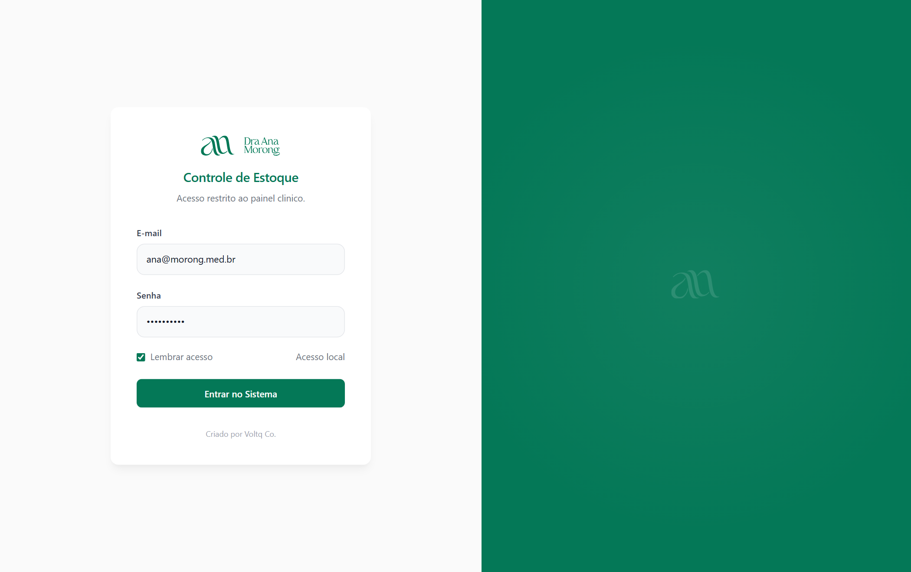

> [!IMPORTANT]
> **Bloqueio automático por segurança:** Se o computador ficar parado por alguns minutos sem ninguém mexer (por exemplo, na hora do almoço), o sistema pode pedir a senha novamente. Isso protege o sigilo médico dos prontuários caso algum acompanhante passe perto da recepção.

## 1.2 Conhecendo a Tela Principal (Onde Fica Cada Coisa)

Assim que você entra, toda a navegação acontece por duas barras muito simples:

- **Menu Lateral Esquerdo (dividido em 4 blocos):**
  - **VISÃO GERAL:** *Dashboard* (resumo do dia) e *Agenda* (horários marcados).
  - **CLÍNICO:** *Pacientes* (fichas e prontuários), *Documentos* (contratos, termos e receitas), *Aplicações* (histórico de sessões) e *Protocolos* (fórmulas padrão da Dra. Ana).
  - **INVENTÁRIO:** *Estoque* (visão completa), *Medicamentos* (vitaminas e ampolas), *Materiais* (seringas, agulhas, gaze), *Equipamentos* e *Etiquetas*.
  - **FINANCEIRO e GESTÃO:** *Financeiro* (caixa, contas a receber e a pagar), *Resumo do Mês*, *Relatórios* e *Configurações*.
- **Barra do Topo (sempre visível em qualquer tela):**
  - **Caixa de Busca Rápida** (*"Buscar pacientes, medicamentos, lotes..."*): basta começar a digitar o nome de uma paciente ou de uma vitamina para encontrá-la na hora, sem precisar trocar de tela.
  - **Sininho de Avisos** (no canto superior direito, com bolinha vermelha quando há novidade): mostra alertas importantes, como um item que está acabando ou um lote próximo do vencimento.
  - **Botão Verde "+ Nova Aplicação"**: atalho direto para abrir um atendimento clínico imediatamente.

## 1.3 Quem Faz o Quê no Dia a Dia (Secretária x Dra. Ana)

Para que a rotina flua com leveza, veja a divisão recomendada das tarefas entre a recepção e o consultório:

| Momento do Dia | Rotina da Secretária / Recepção | Rotina da Dra. Ana |
| :--- | :--- | :--- |
| **Manhã (Abertura)** | Olha o **Dashboard** e a **Agenda**, confere avisos do sininho e confirma os pacientes do dia pelo WhatsApp. | Revisa os pacientes agendados do dia e eventuais observações de alerta nos prontuários. |
| **Chegada do Paciente** | Cadastra ou atualiza telefone/CPF/endereço do paciente e muda o agendamento para **Confirmado**. | Abre o prontuário do paciente para conduzir a consulta ou a sessão planejada. |
| **Contratos Saúde 360®** | Gera a minuta com o plano combinado, envia o link no WhatsApp do paciente, acompanha a assinatura e clica em **Salvar no Drive & E-mail**. | Define na consulta qual plano da Jornada Saúde 360® é indicado para o paciente (a assinatura médica entra sozinha!). |
| **Aplicação Injetável** | Separa a bandeja conferindo o lote/validade sugerido pelo sistema e recebe o pagamento ao final. | Marca o local no **Mapa do Corpo**, confere a evolução médica e clica em **Finalizar & Baixar Estoque**. |
| **Chegada de Caixas** | Confere as ampolas/seringas recebidas, dá entrada pela Nota Fiscal, guarda nos armários/geladeira e cola etiquetas. | Avalia a sugestão de compras mensal antes de autorizar novos pedidos aos laboratórios. |
| **Fim do Expediente** | Confere se todos os atendimentos do dia foram pagos ou lançados em **Contas a Receber** e dá baixa nos boletos pagos. | Acompanha indicadores mensais no **Painel Financeiro** e no **Resumo do Mês**. |

---

# Capítulo 2 - Painel Inicial (Dashboard): O Resumo da Clínica Logo Cedo

**Onde clicar:** Menu lateral esquerdo -> **Dashboard**.
**Quem usa:** Secretária (na abertura do dia) e Dra. Ana (acompanhamento geral).

O **Dashboard** funciona como o painel de controle da clínica. Logo ao chegar pela manhã, ele mostra em poucos segundos se está tudo em ordem com os atendimentos e com o estoque.

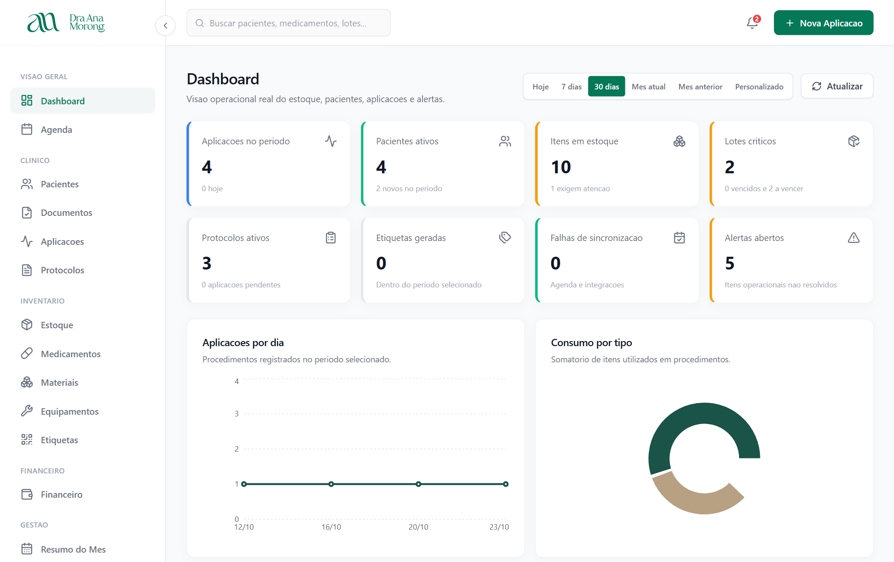

## 2.1 Como Ler os Cartões do Painel

1. **Botões de Período (no canto superior direito):** Você pode alternar entre **Hoje**, **7 dias**, **30 dias**, **Mês atual**, **Mês anterior** ou escolher datas específicas em **Personalizado**. Se quiser recarregar os números na hora, clique em **Atualizar**.
2. **Aplicações no período:** Mostra quantos procedimentos injetáveis já foram finalizados no período escolhido e quantos aconteceram hoje.
3. **Pacientes ativos:** Quantidade total de pacientes em acompanhamento na clínica e quantos cadastros novos entraram no período.
4. **Itens em estoque (borda amarela quando merece atenção):** Mostra o total de produtos cadastrados e avisa na linha de baixo quantos itens estão com estoque baixo precisando de reposição.
5. **Lotes críticos:** Informa se existe algum lote vencido ou quantos lotes vão vencer nos próximos 30 dias — essencial para usar esses itens primeiro e não perder dinheiro!
6. **Falhas de sincronização e Alertas abertos:** Mostram se algum lembrete da agenda ou item operacional precisa de revisão.
7. **Gráficos inferiores (*Aplicações por dia* e *Consumo por tipo*):** Mostram o ritmo de atendimentos da clínica e a proporção entre medicamentos (vitaminas) e materiais descartáveis utilizados.

> [!TIP]
> **Hábito de ouro da recepção:** Toda segunda-feira de manhã, olhe os cartões **Itens em estoque** e **Lotes críticos** no Dashboard e clique no **Sininho** no topo da tela. Se houver algum lote vencendo nas próximas semanas, avise a Dra. Ana para priorizar o uso nas sessões da semana.

---

# Capítulo 3 - Agenda do Dia: Consultas, Aplicações e Confirmações

**Onde clicar:** Menu lateral esquerdo -> **Agenda**.
**Quem usa:** Principalmente a Secretária / Recepção (e a Dra. Ana para visualizar a fila do dia).

A tela de **Agenda** organiza todos os horários do dia em ordem cronológica, separando claramente o que é **Consulta**, o que é **Retorno** e o que é **Aplicação** de injetáveis.

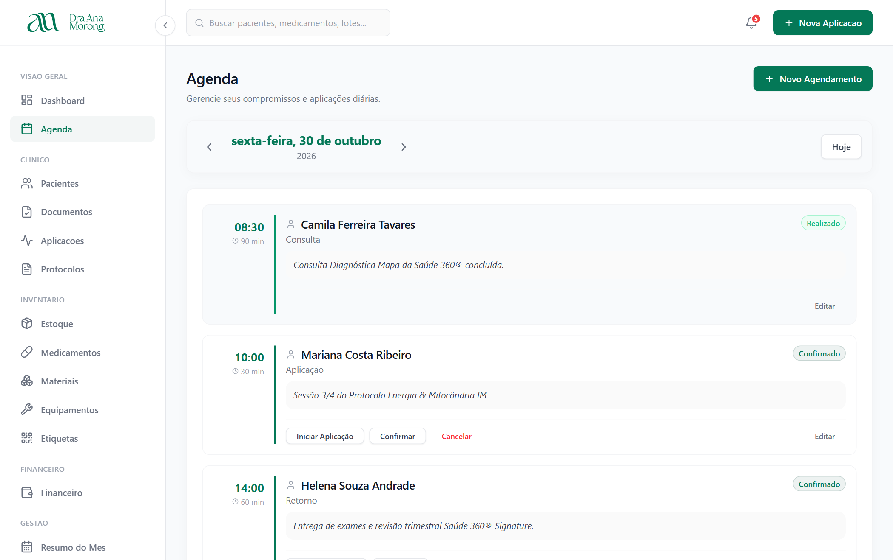

## 3.1 Como Navegar Pelos Dias

- Use as **setinhas (`<` e `>`)** ao lado da data (ex.: *sexta-feira, 30 de outubro*) para olhar os agendamentos de ontem, amanhã ou da próxima semana.
- Se você avançou várias datas para frente e quer voltar rapidamente para o dia atual, basta clicar no botão **Hoje** à direita.

## 3.2 Como Marcar um Novo Horário Passo a Passo

1. Na tela de **Agenda**, clique no botão verde **+ Novo Agendamento** no canto superior direito.
2. Abrirá a janela **Novo Agendamento Clínico**:

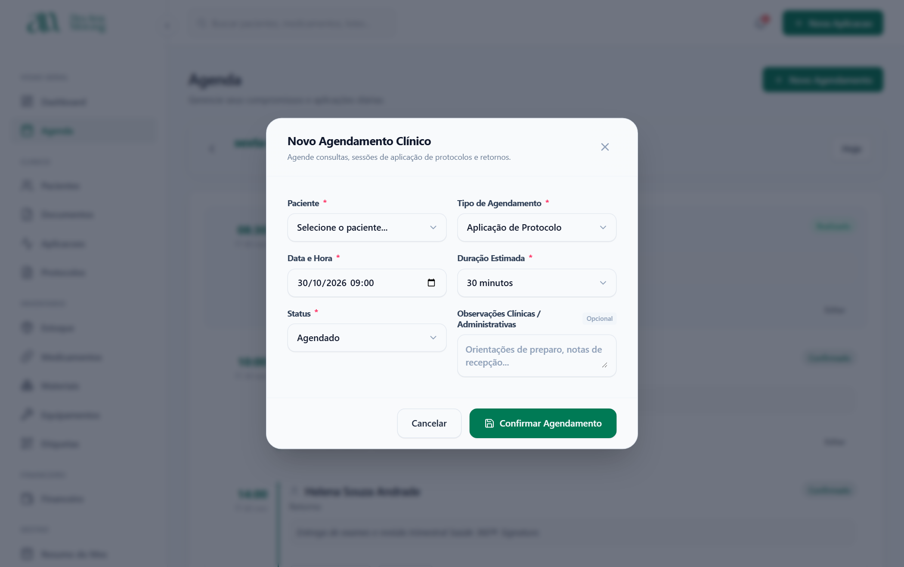

3. **Paciente:** Clique na lista e escolha o paciente (se for a primeira vez dele na clínica e ainda não tiver cadastro, cadastre-o primeiro em *Pacientes* — leva 30 segundos!).
4. **Tipo de Agendamento:** Escolha a opção correta:
   - **Consulta Médica:** consultas iniciais ou completas (ex.: *Mapa da Saúde 360®* de 90 minutos ou acompanhamento longitudinal).
   - **Aplicação de Protocolo:** sessões rápidas na sala de injetáveis (geralmente 30 minutos).
   - **Retorno:** consultas de entrega de exames ou reavaliação.
5. **Data e Hora:** Selecione o dia no calendário e o horário exato.
6. **Duração Estimada:** Escolha o tempo previsto (ex.: *30 minutos* para aplicação, *60 minutos* para retorno, *90 minutos* para primeira consulta).
7. **Status:** Ao marcar com antecedência, deixe como **Agendado**. Quando o paciente confirmar presença pelo WhatsApp na véspera, mude para **Confirmado**.
8. **Observações Clínicas / Administrativas:** Anote recados úteis (ex.: *"Trazer exames laboratoriais impressos"* ou *"Sessão 3 de 4 do protocolo semanal"*).
9. Clique no botão verde **Confirmar Agendamento**.

## 3.3 O Que Acontece nos Bastidores (Google Agenda e Pós-Atendimento)

- **Sincronização com a Agenda Google da Dra. Ana:** Quando a conexão Google está ativa nas Configurações, todo horário criado, remarcado ou cancelado na Agenda do sistema atualiza automaticamente o calendário Google da doutora no celular dela!
- **Iniciar Aplicação com 1 Clique:** Quando o agendamento é do tipo *Aplicação*, aparece no próprio cartão da agenda o botão **Iniciar Aplicação**. Basta clicar nele quando o paciente entrar na sala e o sistema já abre a ficha de aplicação preenchida!
- **Acompanhamento de Carinho Pós-Sessão:** Alguns dias após o procedimento ser concluído (padrão configurável, como 3 dias), o sistema pode enviar um e-mail cordial perguntando como o paciente está se sentindo após a aplicação.

> [!WARNING]
> **Se o paciente desmarcar ou faltar:** Nunca apague o cadastro do paciente! Apenas vá até o horário dele na **Agenda** e clique em **Editar** para mudar a data (se ele remarcou) ou clique em **Cancelar** (se ele desmarcou). Assim o histórico de remarcações fica registrado direitinho.

---

# Capítulo 4 - Pacientes e Prontuário: Cadastro, Alergias e Pacotes de Sessões

**Onde clicar:** Menu lateral esquerdo -> **Pacientes**.
**Quem usa:** Secretária (cadastro e dados pessoais) e Dra. Ana (alertas médicos, evoluções e plano de aplicações).

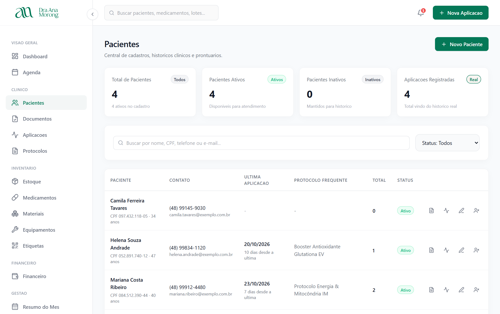

## 4.1 Como Cadastrar um Novo Paciente Sem Erros

1. No menu lateral esquerdo, clique em **Pacientes**.
2. **Antes de criar, sempre pesquise!** Digite o primeiro nome ou o CPF na barra *"Buscar por nome, CPF, telefone ou e-mail..."* para ter certeza de que o paciente ainda não está cadastrado.
3. Clique no botão verde **+ Novo Paciente** no canto superior direito.
4. Preencha com capricho:
   - **Nome Completo** (sem abreviações, pois esse nome sairá automaticamente nos Contratos Saúde 360® e nas receitas!).
   - **CPF** (indispensável para validade jurídica da assinatura eletrônica no contrato).
   - **Telefone / WhatsApp com DDD** (ex.: `(48) 99912-4480` — usado para enviar o link de assinatura em 1 clique).
   - **E-mail** (para onde o sistema enviará a cópia assinada do contrato em PDF).
   - **Data de Nascimento** e **Endereço completo** (rua, número, bairro, cidade e CEP — exigidos na cláusula de identificação dos contratos).
   - **Observações Gerais:** notas administrativas ou de contexto (ex.: *"Programa Saúde 360® Evolution"*).
   - **Observações de Alerta (Alergias / Cuidados Especiais):** preencha sempre que o paciente relatar alergia medicamentosa (ex.: *Dipirona, Iodo, Látex, Esparadrapo comum*), uso de anticoagulantes ou histórico de queda de pressão ao ver agulha.
5. Clique em **Salvar**.

## 4.2 Conhecendo o Prontuário Completo do Paciente

Ao clicar sobre o nome de qualquer paciente na lista, abre-se o **Prontuário Completo**:

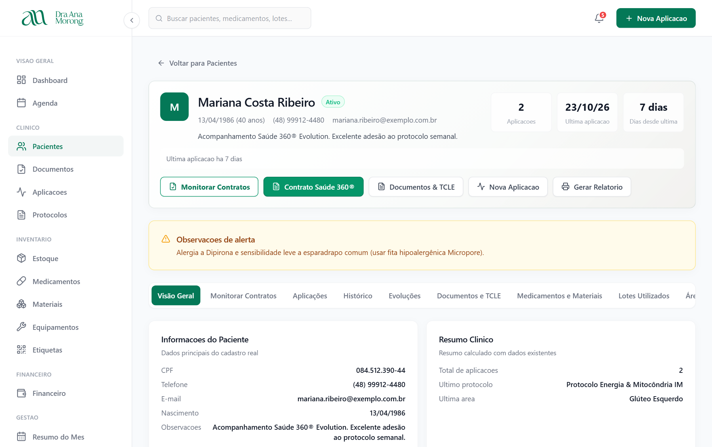

Repare como tudo o que importa salta aos olhos imediatamente:
- **Cabeçalho Inteligente:** Mostra idade calculada automaticamente, telefone, e-mail, quantas aplicações o paciente já fez, a data da última sessão e **quantos dias se passaram desde a última aplicação**.
- **5 Botões Rápidos de Ação:**
  1. **Monitorar Contratos:** vê se o paciente já assinou o contrato enviado.
  2. **Contrato Saúde 360®:** abre o gerador oficial de contratos já com todos os dados desse paciente preenchidos!
  3. **Documentos & TCLE:** emite Termo de Consentimento, Atestado, Receituário ou Recibo.
  4. **Nova Aplicação:** abre uma sessão avulsa na hora.
  5. **Gerar Relatório:** gera um extrato clínico limpo das aplicações do paciente para impressão ou PDF.
- **Faixa Amarela "Observações de alerta":** Sempre que houver alergia ou restrição cadastrada, essa faixa amarela aparece aberta em destaque logo abaixo do cabeçalho para que nem a Dra. Ana nem a enfermagem passem despercebidas!

### Para que serve cada aba do Prontuário:
- **Visão Geral:** Dados cadastrais e resumo do último protocolo e da última região do corpo aplicada.
- **Monitorar Contratos:** Painel exclusivo dos contratos daquele paciente (assinados, aguardando assinatura e salvos no Google Drive).
- **Aplicações:** Onde planejamos pacotes de sessões futuras (veja abaixo!).
- **Histórico & Evoluções:** Textos clínicos completos assinados em cada sessão passada.
- **Documentos e TCLE:** Todos os termos, receitas e atestados do paciente.
- **Medicamentos e Materiais / Lotes Utilizados:** Mostra exatamente quais ampolas, números de lote e validades foram aplicados nesse paciente ao longo de todo o tratamento.

## 4.3 Como Planejar um Pacote de Várias Sessões de Uma Vez (Aba Aplicações)

Muitos protocolos injetáveis têm **4, 6, 8 ou 12 sessões semanais ou quinzenais**. Em vez de lançar uma por uma toda semana, faça assim:

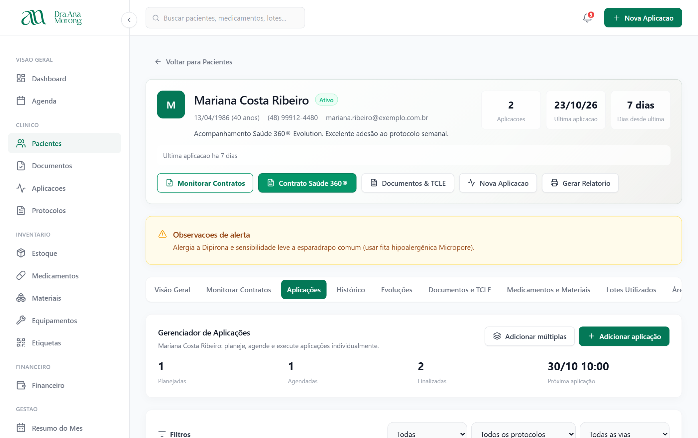

1. Dentro do prontuário do paciente, clique na aba **Aplicações**.
2. Para agendar **uma única sessão futura**, clique no botão verde **+ Adicionar aplicação**.
3. Para deixar um **ciclo inteiro planejado** (por exemplo, 4 aplicações semanais todas as sextas-feiras às 10h), clique em **Adicionar múltiplas**:
   - Escolha o **Protocolo** (ex.: *Protocolo Energia & Mitocôndria IM*).
   - Informe quantas sessões serão feitas (ex.: `4`), a data da primeira e o intervalo (semanal ou quinzenal).
   - Confirme! O sistema criará todas as sessões planejadas e já poderá vinculá-las à **Agenda**, facilitando o controle de quantas sessões o paciente já cumpriu e quantas ainda faltam!

---

# Capítulo 5 - Estoque Sem Complicação: Armários, Materiais e Ampolas em ml

**Onde clicar:** Menu lateral esquerdo -> **Estoque** (ou *Medicamentos* / *Materiais* / *Equipamentos*).
**Quem usa:** Secretária (cadastros e conferência) e Dra. Ana (definição de valores e estoque mínimo).

O controle de estoque foi desenhado para responder a três perguntas vitais da clínica: **quanto temos hoje**, **qual lote vence primeiro** e **quanto custa cada sessão de verdade**.

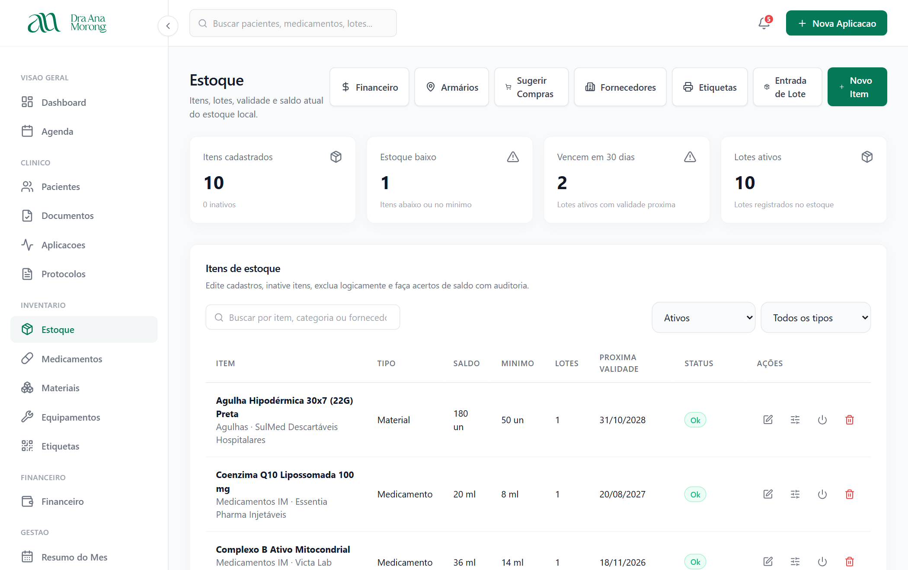

## 5.1 Os Botões do Topo da Tela de Estoque

Na parte superior direita da tela **Estoque**, você encontra 7 botões super práticos:
1. **Financeiro:** mostra quanto dinheiro a clínica tem guardado hoje em ampolas e materiais na prateleira.
2. **Armários:** permite cadastrar os locais físicos reais onde você guarda os produtos (ex.: *Armário Principal da Sala de Injetáveis*, *Geladeira de Termolábeis 2°C a 8°C*, *Estoque Reserva da Recepção*). Assim ninguém perde tempo procurando onde está cada caixa!
3. **Sugerir Compras:** lista pronta do que está acabando para mandar aos fornecedores.
4. **Fornecedores:** agenda com CNPJ, telefone, e-mail e nome do consultor de cada laboratório (ex.: *Essentia Pharma*, *Victa Lab*, *Distribuidora Hospitalar*).
5. **Etiquetas:** abre a tela de impressão de etiquetas com QR Code.
6. **Entrada de Lote:** registra a chegada de uma caixa nova comprada.
7. **+ Novo Item:** cadastra um medicamento, material ou equipamento inédito que a clínica nunca comprou antes.

> [!NOTE]
> **Quando usar "+ Novo Item" e quando usar "Entrada de Lote"?**
> - Use **+ Novo Item** apenas **uma única vez** na vida do produto (quando a clínica passa a trabalhar com uma vitamina ou seringa nova).
> - Quando chegar uma nova remessa de uma vitamina que **já existe** no sistema (ex.: chegou mais uma caixa de Vitamina B12), **não crie Novo Item!** Clique sempre em **Entrada de Lote**.

## 5.2 A Regra de Ouro dos Medicamentos: Controle Sempre em Mililitros (`ml`)

Para que a Dra. Ana possa aplicar meia ampola, uma ampola inteira de `2 ml` ou aspirar `3,5 ml` de um frasco maior sem nunca dar erro na conta do estoque, **todos os medicamentos líquidos da clínica são controlados em mililitros (`ml`)**.

Veja na imagem abaixo como é simples cadastrar ou editar um medicamento:

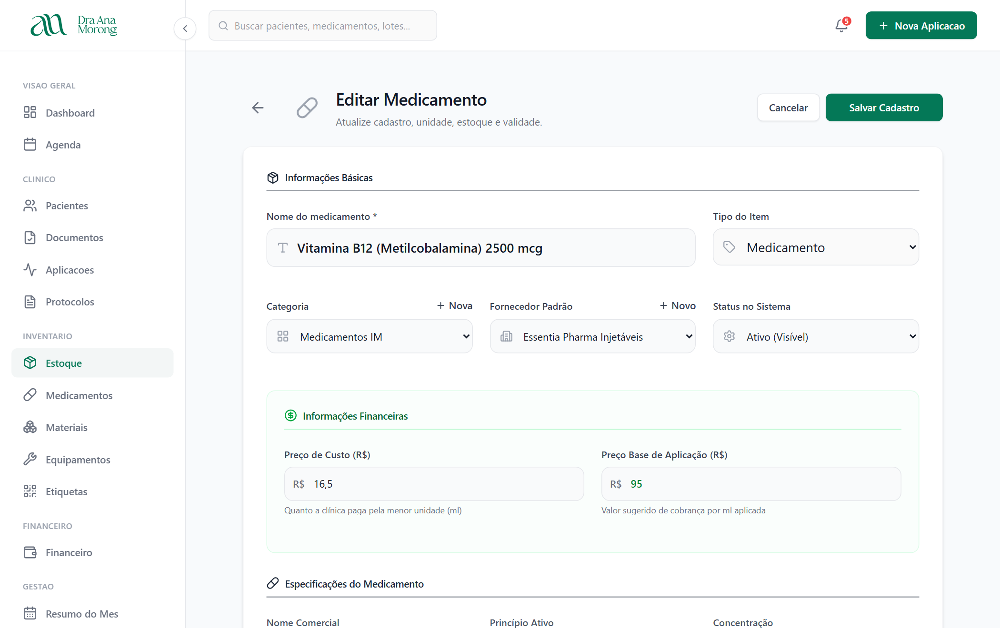

### Passo a passo para cadastrar um Medicamento sem errar a conta:
1. Clique em **Estoque -> + Novo Item** (ou em **Medicamentos -> + Novo Medicamento**).
2. **Nome do medicamento:** Escreva um nome claro com a concentração (ex.: *Vitamina B12 (Metilcobalamina) 2500 mcg*).
3. **Categoria e Fornecedor Padrão:** Escolha a via principal (ex.: *Medicamentos IM* ou *Medicamentos EV*) e o laboratório onde costuma comprar.
4. **Preço de Custo (R$) — MUITO IMPORTANTE:** Informe quanto custa **1 ml** da substância!
   - *Exemplo fácil 1 (Ampola de 2 ml):* O laboratório cobrou **R\$ 33,00** por uma ampola de **2 ml**. Divida `33 ÷ 2` = digite **`16,50`** no Preço de Custo!
   - *Exemplo fácil 2 (Frasco de 5 ml):* O frasco de Glutationa de **5 ml** custou **R\$ 95,00**. Divida `95 ÷ 5` = digite **`19,00`** no Preço de Custo!
   - *Exemplo fácil 3 (Frasco multidose de 10 ml):* O frasco de **10 ml** custou **R\$ 120,00**. Divida `120 ÷ 10` = digite **`12,00`** no Preço de Custo!
5. **Conversão da Embalagem (mais abaixo na mesma tela):** Informe se ele vem em *ampola* ou *frasco* e quantos `ml` vêm dentro de cada unidade (ex.: `1 ampola = 2 ml`). Assim, na hora de dar entrada na nota fiscal, o sistema faz a multiplicação para você!
6. **Estoque Mínimo:** Informe com quantos `ml` você quer que o sistema acenda o alerta de compra (ex.: `12 ml`, equivalente a 6 ampolas de 2 ml).
7. Clique em **Salvar Cadastro**.

## 5.3 Como Cadastrar Seringas, Agulhas e Outros Materiais

Diferente dos líquidos, os **Materiais Descartáveis** são contados em **unidades (`un`)**.

> [!TIP]
> **Dica importante para o Resumo do Mês funcionar perfeitamente:** Ao cadastrar seringas, sempre escreva o tamanho no nome do item — por exemplo: **`Seringa Descartável 3ml`**, **`Seringa Descartável 5ml`**, **`Seringa Descartável 10ml`** ou **`Seringa 20ml`**. Dessa forma, no final do mês o sistema separa sozinho quantas seringas de 3ml, 5ml e 10ml foram usadas!

## 5.4 Controle de Equipamentos do Consultório (Geladeira, Centrífuga, Aparelhos)

No menu lateral esquerdo, logo abaixo de *Materiais*, clique em **Equipamentos**:
- Ali ficam registrados os aparelhos permanentes da clínica (ex.: *Geladeira de Termolábeis*, *Termômetro Digital de Máxima e Mínima*, *Centrífuga*, *Oxímetro*, *Esfigmomanômetro*).
- Você pode anotar o **número de série**, a **data da última revisão/calibração** e a **data da próxima manutenção preventiva**, mantendo o consultório sempre organizado para qualquer conferência da Vigilância Sanitária.

---

# Capítulo 6 - Chegada de Mercadoria: Nota Fiscal, Etiquetas e Quebra de Ampola

**Onde clicar:** Menu lateral esquerdo -> **Estoque** -> botão **Entrada de Lote**.
**Quem usa:** Secretária / Recepção (sempre que o entregador deixar mercadoria na clínica).

Quando uma caixa de laboratório ou distribuidora hospitalar chega na recepção, siga sempre este ritual rápido de 4 passos:

1. **Abra a caixa e confira fisicamente:** Verifique se nenhuma ampola veio trincada, se os termolábeis vieram resfriados e anote o **Número do Lote** e a **Data de Validade** impressos no rótulo dos frascos.
2. **Dê entrada no sistema** (pelo arquivo da Nota Fiscal ou manualmente).
3. **Imprima e cole a etiqueta** de identificação na bandeja ou caixa organizadora.
4. **Guarde no armário ou geladeira correspondente** colocando os lotes que vencem antes na frente!

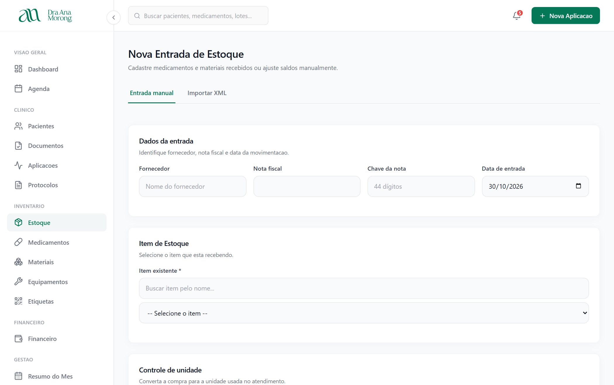

## 6.1 Opção A — Entrada Rápida pelo Arquivo da Nota Fiscal (Aba "Importar XML")

Todo fornecedor envia por e-mail, junto com o PDF da nota e os boletos, um arquivinho terminado em **`.xml`**. Ele economiza muito trabalho de digitação:

1. Salve o arquivo `.xml` do e-mail do fornecedor na pasta *Downloads* do computador.
2. No sistema, vá em **Estoque -> Entrada de Lote** e clique na aba **Importar XML**.
3. Selecione o arquivo `.xml` salvo no computador.
4. O sistema lerá automaticamente o nome do fornecedor, o número da Nota Fiscal, os valores e todos os produtos da nota!
5. Na tabela de conferência que aparecerá na tela, relacione cada linha da nota ao item correspondente da clínica, confira o **Lote**, a **Validade**, o **Armário/Geladeira** de destino e a conversão em `ml` (ex.: 10 ampolas de 2 ml = `20 ml` entrando no saldo).
6. Se a compra tiver boleto parcelado ou a prazo, marque a opção de **gerar conta a pagar no Financeiro** para já deixar o vencimento do boleto agendado!
7. Clique em **Confirmar Entrada**.

## 6.2 Opção B — Entrada Manual (Quando Vier Cupom ou Pedido Sem XML)

Se o pedido veio de farmácia de manipulação magistral sem arquivo `.xml`, use a aba **Entrada manual**:
1. Preencha o **Fornecedor**, o número da **Nota fiscal / Pedido** e a **Data de entrada**.
2. Em **Item existente**, pesquise e selecione o medicamento ou material que chegou.
3. Informe a **Quantidade recebida** (prestando atenção se está informando em ampolas com conversão ou direto em `ml`/`un`), o **Número do Lote**, a **Data de Validade** e o **Custo**.
4. Escolha em qual **Armário / Geladeira** ficará guardado e salve.

## 6.3 Como Imprimir Etiquetas com QR Code

**Onde clicar:** Menu lateral esquerdo -> **Etiquetas**.

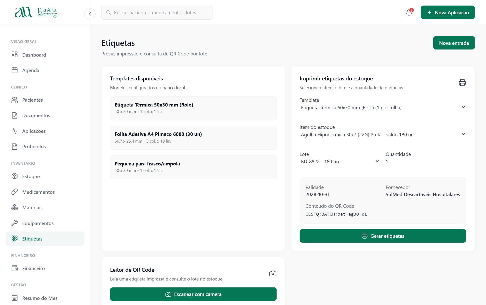

1. Escolha o **Template (Modelo de Etiqueta)** que está na sua impressora:
   - **Etiqueta Térmica 50x30 mm (Rolo):** para impressoras térmicas de etiquetas (tipo Zebra ou Elgin).
   - **Folha Adesiva A4 Pimaco 6080 (30 unidades):** para impressora comum usando folha adesiva de papelaria.
2. Em **Item do estoque**, escolha o produto que acabou de chegar.
3. Escolha o **Lote** recém-cadastrado e digite a **Quantidade** de etiquetas que deseja imprimir.
4. Clique no botão verde **Gerar etiquetas** e mande imprimir.
5. **Dica extra:** Na parte de baixo da tela há o botão **Escanear com câmera**. Se você apontar a câmera do celular ou webcam para qualquer etiqueta colada em um frasco, o sistema mostra na hora a validade e quanto ainda resta daquele lote!

## 6.4 E Se Quebrar uma Ampola na Bancada ou Faltar Item na Contagem?

Acidentes acontecem no dia a dia! Se uma ampola escorregar e quebrar durante o preparo, ou se na contagem da sexta-feira você notar que há 1 seringa a menos na gaveta:

1. Vá em **Estoque** no menu lateral.
2. Localize o item na lista e clique no **ícone de ajuste de saldo** (os tracinhos de regulagem na coluna *Ações*, ao lado do lápis de editar).
3. Informe a saída/ajuste, escolha o lote afetado e **escreva o motivo real** na justificativa (ex.: *"1 ampola de 2 ml trincou na abertura durante preparo de bandeja"* ou *"Acerto de contagem física da gaveta"*).
4. Confirme! Dessa forma o saldo do estoque fica 100% verdadeiro e a Dra. Ana sabe exatamente o motivo daquela baixa.

---

# Capítulo 7 - Protocolos Clínicos: As Receitas de Atendimento da Dra. Ana

**Onde clicar:** Menu lateral esquerdo -> **Protocolos**.
**Quem usa:** Principalmente a Dra. Ana (para montar e atualizar as fórmulas padrão da clínica).

Os **Protocolos Clínicos** funcionam como um "kit pronto de atendimento". Em vez de escolher item por item a cada paciente que entra na sala, basta selecionar o protocolo e o sistema já carrega em 1 segundo **todas as vitaminas, seringas, agulhas, gaze/álcool e o preço sugerido da sessão**!

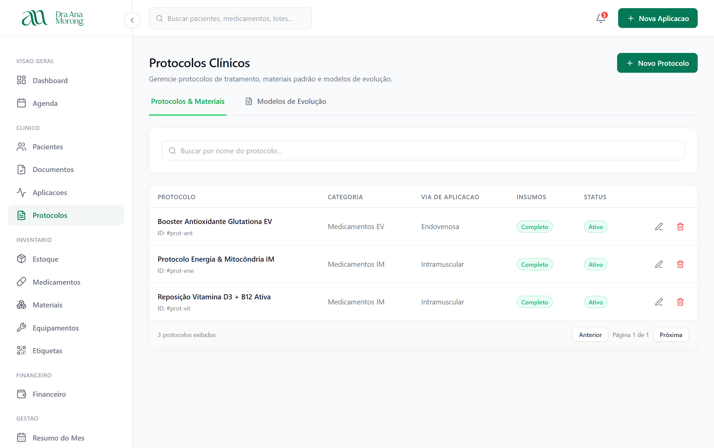

## 7.1 Como Criar um Novo Protocolo Completo Passo a Passo

1. No menu lateral esquerdo, clique em **Protocolos** e depois no botão verde **+ Novo Protocolo**.
2. **Nome do Protocolo:** Dê um nome claro (ex.: *Protocolo Energia & Mitocôndria IM* ou *Booster Antioxidante Glutationa EV*).
3. **Categoria e Via de Aplicação:** Escolha se é *Intramuscular (IM)*, *Endovenosa (EV)* ou *Subcutânea (SC)*.
4. **Valor Base da Sessão (R$):** Digite quanto a clínica cobra do paciente por essa sessão (ex.: `R$ 420,00`). Esse valor já virá preenchido na hora do pagamento!
5. **Lista de Medicamentos e Materiais do Protocolo:** Adicione **tudo** o que vai na bandeja daquela sessão:
   - As vitaminas com suas doses em **`ml`** (ex.: *Vitamina B12 — 2 ml* + *Complexo B — 2 ml*).
   - Os descartáveis em **`un`** (ex.: *1 Seringa Descartável 5ml* + *1 Agulha 30x7* + *1 Sachê de Álcool 70%*).
6. **Modelo de Evolução Padrão:** Vincule um texto-base de evolução médica para economizar digitação no final do atendimento.
7. Clique em **Salvar Protocolo**.

> [!IMPORTANT]
> **Repare na coluna "INSUMOS" da tela de Protocolos:** Quando aparece o selo verde **Completo**, significa que o protocolo já tem tanto os medicamentos quanto a seringa e a agulha cadastrados! Se algum protocolo aparecer com aviso amarelo informando falta de seringa ou agulha, clique no lápis de editar e inclua os descartáveis — assim o estoque de seringas e agulhas é baixado sozinho a cada aplicação!

## 7.2 Aba "Modelos de Evolução" (Textos Automáticos para o Prontuário)

Na parte superior da tela de **Protocolos**, ao clicar na aba **Modelos de Evolução**, a Dra. Ana pode deixar prontos os textos clínicos que mais utiliza. O sistema substitui automaticamente o nome do paciente, a data do dia, o protocolo aplicado e a região do corpo escolhida, deixando o texto pronto para revisão final!

---

# Capítulo 8 - Sala de Aplicação: Mapa do Corpo, Baixa de Estoque e Correções

**Onde clicar:** Na **Agenda** -> botão **Iniciar Aplicação** (ou pelo botão verde **+ Nova Aplicação** no topo da tela).
**Quem usa:** Dra. Ana (durante o atendimento) e Secretária (conferência de pagamento no fechamento).

Esta é a tela central da sala de injetáveis! Ela foi dividida em **3 colunas lado a lado** para que tudo possa ser conferido num único olhar:

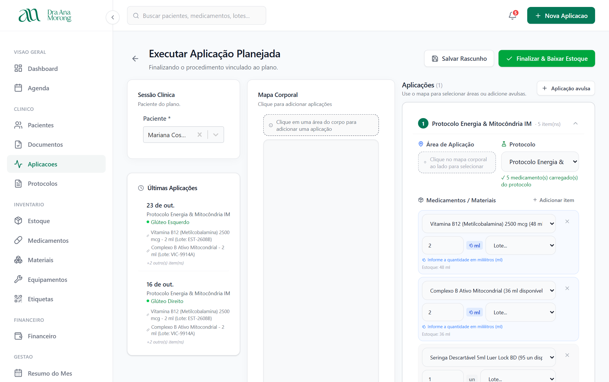

## 8.1 Passo a Passo de Uma Aplicação Clínica

1. **Coluna da Esquerda — Conferência do Paciente e Rodízio de Local:**
   - Confira o nome do paciente no topo.
   - Olhe logo abaixo o quadro **Últimas Aplicações**: ali o sistema mostra exatamente onde foi feita a injeção anterior (ex.: em *23 de out.* foi no **Glúteo Esquerdo**; em *16 de out.* foi no **Glúteo Direito**). Isso ajuda a alternar o lado a cada semana para maior conforto do paciente!
2. **Coluna do Meio — Mapa Corporal:**
   - Clique diretamente sobre a região do corpo onde será feita a aplicação de hoje (ex.: *Glúteo Direito*, *Deltóide Esquerdo*, *Antebraço Direito* para soroterapia ou *Abdômen* para subcutânea).
   - Se o paciente for receber **duas injeções em locais diferentes na mesma visita** (por exemplo, uma ampola oleosa no Glúteo Direito e outra aquosa no Glúteo Esquerdo), basta clicar nas duas regiões no mapa ou no botão **+ Aplicação avulsa**!
3. **Coluna da Direita — Conferência de Doses e Lotes (Ordem Inteligente de Validade):**
   - Ao escolher o **Protocolo**, todos os medicamentos e seringas já aparecem carregados.
   - Se a Dra. Ana decidir ajustar a dose daquele dia (por exemplo, aplicar `1,5 ml` em vez de `2 ml`, ou acrescentar mais uma ampola clicando em **+ Adicionar item**), basta ajustar ali mesmo.
   - Em **Lote**, o sistema **já sugere automaticamente o lote válido que vence mais cedo** (para nenhum frasco esquecido vencer no fundo do armário!) e **bloqueia lotes vencidos** para total segurança do paciente. Confira sempre se o número do lote na tela bate com a ampola que está na sua mão!
4. **Parte Inferior da Tela — Evolução Médica e Fechamento Financeiro:**
   - Role levemente a tela para baixo para revisar o **Texto de Evolução Clínica** (se houve alguma reação leve, como ardência local ou pequeno hematoma, marque a opção **Houve intercorrência** e descreva brevemente para aparecer nas próximas visitas).
   - No quadro de **Valores e Pagamento**, confira o valor da sessão, eventual desconto autorizado, a **Forma de Pagamento** (*PIX, Cartão de Crédito, Débito, Dinheiro*) e se já está **Pago** ou **Pendente** (para acertar na recepção na saída).

## 8.2 Diferença Entre "Salvar Rascunho" e "Finalizar & Baixar Estoque"

No canto superior direito da Sala de Aplicação existem dois botões diferentes:

| Botão | O que ele faz | Quando usar |
| :--- | :--- | :--- |
| **Salvar Rascunho** | Guarda tudo preenchido na tela, mas **ainda não desconta do estoque** nem fecha a sessão. | Quando a recepção ou enfermagem deixa a ficha pré-separada antes de o paciente entrar na sala. |
| **Finalizar & Baixar Estoque** | Conclui o atendimento de vez: **desconta os ml e seringas do estoque**, grava a evolução no prontuário, atualiza a Agenda como *Realizado* e lança o valor no Financeiro! | Assim que a aplicação for efetivamente realizada no paciente. |

## 8.3 Como Corrigir ou Estornar Se Alguém Finalizar por Engano

*"Doutora, cliquei em Finalizar sem querer no paciente errado (ou com a dose errada), e agora?!"*
Fique tranquila! O sistema tem um botão próprio de **Reversão Segura**:

1. No menu lateral esquerdo, clique em **Aplicações** (logo abaixo de *Documentos*).
2. Localize na lista o atendimento que foi finalizado por engano.
3. Clique na opção de **Estornar / Reverter Procedimento** e escreva o motivo (ex.: *"Lançado com quantidade de ml incorreta, será refeito"*).
4. O sistema **devolve automaticamente os mililitros e as seringas para os mesmos lotes do estoque** e cancela a cobrança financeira vinculada, deixando tudo limpo para você lançar o atendimento correto!

---

# Capítulo 9 - Contratos Jornada Saúde 360®: Gerando o Contrato em 1 Minuto

**Onde clicar:** Dentro do **Prontuário do Paciente** -> botão verde **Contrato Saúde 360®** (ou em **Documentos -> + Emitir Novo Documento -> Contrato Jornada Saúde 360®**).
**Quem usa:** Secretária / Recepção (emissão e envio) e Dra. Ana (definição do programa indicado).

O **Estúdio de Contratos — Jornada Saúde 360®** preenche sozinho todas as cláusulas jurídicas, prazos, valores, número de consultas, dados da paciente e dados da clínica, sem precisar editar arquivos no Word!

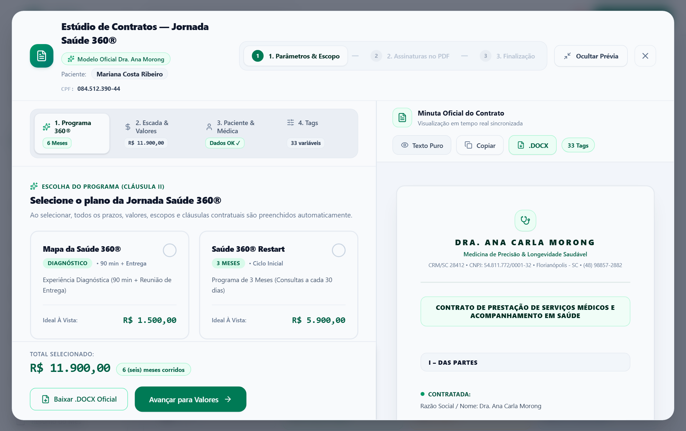

## 9.1 Resumo Rápido dos 6 Planos Disponíveis no Estúdio

Para facilitar a conferência na recepção na hora de emitir, veja os 6 programas oficiais já cadastrados:

| Programa Saúde 360® | Duração / Formato | Resumo para Conferência na Recepção |
| :--- | :--- | :--- |
| **Mapa da Saúde 360®** | Consulta Diagnóstica | Consulta aprofundada (90 min) + reunião de entrega do plano terapêutico. |
| **Saúde 360® Restart** | **3 meses** | Ciclo inicial de acompanhamento com consultas a cada 30 dias. |
| **Saúde 360® Evolution** | **6 meses** | Ciclo intermediário estruturado com consultas a cada 45 dias. |
| **Saúde 360® Signature** | **12 meses** | Programa anual completo de longevidade e acompanhamento contínuo. |
| **Manutenção 6 Meses** | **6 meses** | Continuidade exclusiva para pacientes que já concluíram um ciclo anterior. |
| **Manutenção 12 Meses** | **12 meses** | Continuidade anual para pacientes já acompanhados pela Dra. Ana. |

## 9.2 Passo a Passo Para Gerar o Contrato sem Erros

1. Abra o **Prontuário do Paciente** e clique no botão verde **Contrato Saúde 360®**.
2. **Aba 1 — Programa 360®:** Clique sobre o cartão do plano escolhido pelo paciente (ex.: *Saúde 360® Evolution — 6 meses*). Repare que na metade direita da tela a **Minuta Oficial do Contrato** já muda na mesma hora! Clique no botão verde **Avançar para Valores ->**.
3. **Aba 2 — Escada & Valores (Forma de Pagamento):**
   - Escolha se o paciente vai fechar na condição especial **À Vista (PIX / Transferência)** ou **Parcelado no Cartão de Crédito** (escolhendo o número de parcelas combinado).
   - Se a Dra. Ana concedeu alguma condição personalizada, você pode ajustar o valor ali mesmo e o sistema escreve automaticamente o valor por extenso nas cláusulas!
4. **Aba 3 — Paciente & Médica:**
   - Confira se **Nome Completo, CPF, Endereço, Telefone e E-mail** do paciente estão todos preenchidos com o selo verde **Dados OK**. (Se faltar o endereço ou CEP do paciente, preencha ali mesmo na hora!).
5. **Avançar para Etapa 2 (Assinaturas no PDF):**
   - Clique no botão verde para gerar o PDF oficial do contrato.
   - Na tela do documento em PDF, confira onde ficará o quadro da assinatura do paciente (você pode clicar para posicionar o retângulo tracejado bem sobre a linha de assinatura do Contratante na última página!).
   - Confirme a geração do documento!

---

# Capítulo 10 - Assinatura pelo WhatsApp, Documentos Clínicos e Google Drive

**Onde clicar:** Aba **Monitorar Contratos** dentro do Prontuário, ou menu lateral -> **Documentos**.
**Quem usa:** Secretária / Recepção (envio por WhatsApp e salvamento no Drive) e Paciente (pelo próprio celular).

## 10.1 Como Enviar o Link para o Paciente Assinar no Próprio Celular

Assim que o contrato (ou Termo de Consentimento) é gerado na etapa anterior, o sistema cria um **Link Exclusivo de Assinatura** para o paciente. Ele **não precisa baixar nenhum aplicativo nem criar senha**!

1. Clique no botão **Enviar por WhatsApp** (ou **Copiar Link de Assinatura**).
2. Envie para o WhatsApp do paciente. Se quiser uma mensagem cordial pronta para usar na recepção, copie este modelo:

> *"Olá, [Nome da Paciente]! Tudo bem? Segue abaixo o link seguro do seu Contrato da Jornada Saúde 360® aqui da Clínica Dra. Ana Carla Morong. Basta tocar no link pelo celular, conferir o documento e assinar com o dedo na tela. Assim que concluir, sua via oficial já vai direto para o seu e-mail!"*

## 10.2 Como Orientar o Paciente Caso Ele Peça Ajuda (Visão do Celular/Computador)

Quando o paciente toca no link enviado no WhatsApp, ele vê esta tela limpa e guiada em 3 passos simples:

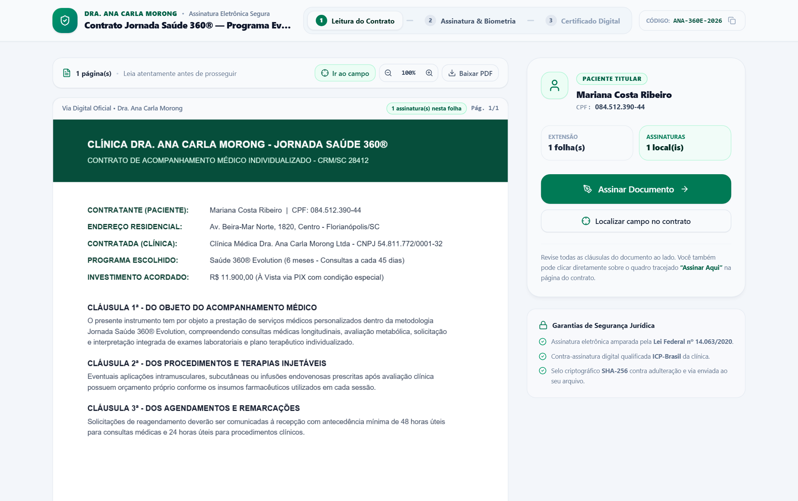

Se o paciente estiver na recepção ou perguntar no WhatsApp como fazer, basta explicar em 3 frases:
1. **Passo 1 (Leitura):** Ele lê o contrato na tela e toca no botão verde **Assinar Documento ->**.
2. **Passo 2 (Assinatura na Tela e Foto):** Ele desenha a assinatura com a ponta do dedo no quadro branco, tira uma foto rápida de confirmação pelo celular (se solicitada) e marca a caixinha confirmando que leu e concorda.
3. **Passo 3 (Pronto!):** Assim que o paciente confirma, **o sistema aplica sozinho a assinatura oficial do Certificado Digital da Dra. Ana**, gera o QR Code de autenticidade no rodapé e libera o botão para ele baixar o PDF assinado na hora!

## 10.3 Acompanhando Contratos e Salvando no Google Drive + E-mail

Para saber se o paciente já assinou (mesmo que ele tenha ido assinar em casa), você tem dois lugares super visuais:

### 1) Dentro da ficha do próprio paciente (Aba "Monitorar Contratos"):

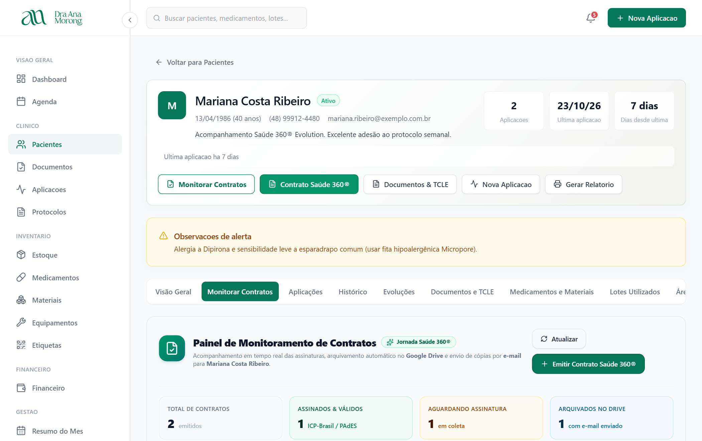

### 2) Na Central Geral de Documentos de toda a clínica (Menu lateral -> Documentos):

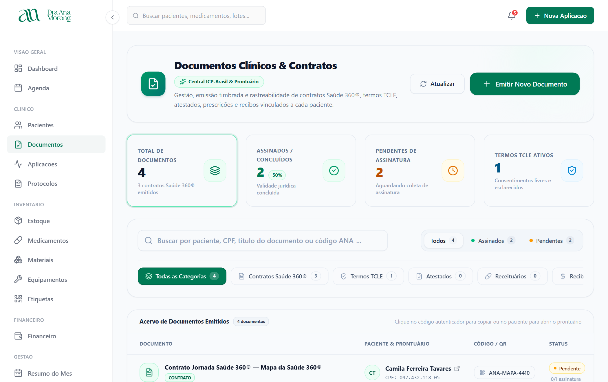

### O que fazer quando o contrato ficar verde ("Assinado / Concluído"):
1. Na linha do contrato assinado, verifique se ele já aparece como **Arquivado no Drive**.
2. Caso ainda esteja aguardando envio ou você queira reenviar a cópia para o e-mail do paciente, basta clicar no botão **Salvar no Drive & E-mail**!
3. O sistema cria automaticamente a pasta organizada do paciente lá no **Google Drive da clínica**, salva o PDF assinado dentro dela e dispara um e-mail elegante com o contrato em anexo para o paciente e para o e-mail da clínica!

## 10.4 Emitindo Outros Documentos (Termo TCLE, Atestado, Receituário e Recibo)

Na tela **Documentos** (botão verde **+ Emitir Novo Documento**) ou dentro do prontuário (**Documentos & TCLE**), você também emite em papel timbrado da Dra. Ana:
- **Termos de Consentimento (TCLE):** essenciais antes de terapias injetáveis endovenosas ou intramusculares — o paciente também pode assinar no celular ou tablet exatamente como faz no contrato!
- **Atestados Médicos, Receituários / Prescrições e Recibos:** já saem formatados com cabeçalho da clínica, CRM/SC e assinatura digital.

## 10.5 Como Funciona o Código e o QR Code de Conferência do Contrato

Todo documento assinado pela clínica ganha no rodapé um **Código de Autenticidade** (como `ANA-360E-2026`) e um **QR Code**. Se o paciente, contador ou qualquer pessoa apontar a câmera do celular para esse QR Code no PDF impresso ou na tela, abre-se uma página oficial da clínica confirmando na hora que aquele contrato é autêntico, a data e o minuto exato das assinaturas!

---

# Capítulo 11 - Financeiro do Dia a Dia: Recebimentos, Contas a Pagar e Caixa

**Onde clicar:** Menu lateral esquerdo -> **Financeiro**.
**Quem usa:** Secretária / Recepção (lançamento diário de pagamentos e boletos) e Dra. Ana (análise de faturamento e margem).

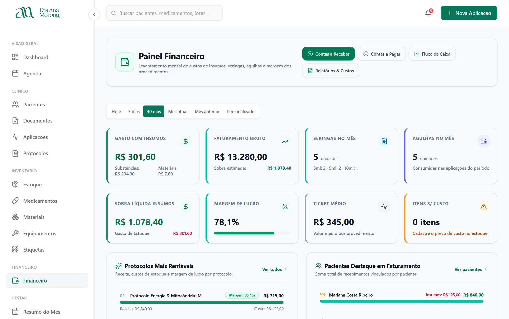

## 11.1 Entendendo o Painel Financeiro

Logo na entrada do módulo **Financeiro**, você escolhe o período (*Hoje, 7 dias, 30 dias, Mês atual*) e vê de forma cristalina:
- **Gasto com Insumos:** quanto custaram de verdade as ampolas, seringas e agulhas usadas nos pacientes atendidos naquele período.
- **Faturamento Bruto e Sobra Líquida Insumos:** quanto entrou de procedimentos/programas e quanto sobrou descontando o custo das substâncias.
- **Margem de Lucro e Ticket Médio:** percentual de rentabilidade e valor médio por atendimento.
- **Itens s/ Custo (Alerta Importante!):** se aparecer algum número maior que zero aqui, significa que algum medicamento foi cadastrado sem preço de custo no estoque — clique para preencher o custo e manter a conta do mês exata!

## 11.2 Como Receber de um Paciente (Contas a Receber)

No topo direito do Painel Financeiro, clique no botão verde **Contas a Receber**:
- **Atendimentos vindos da Sala de Aplicação:** já aparecem criados automaticamente! Se o paciente estava como *Pendente* enquanto se vestia na sala e agora passou na recepção para pagar no PIX ou cartão, basta localizar o nome dele e clicar em **Dar Baixa / Receber**, escolhendo a forma de pagamento.
- **Contratos Saúde 360® ou Consultas Avulsas:** clique em **+ Nova Conta a Receber**, escolha o paciente, a categoria (*Consultas* ou *Programas*), o valor, o vencimento e a forma de pagamento (*PIX, Cartão de Crédito, Transferência*).
- **E se o paciente pagar metade hoje no PIX e o restante semana que vem?** Basta informar no recebimento o **valor pago hoje**! O sistema registra a entrada parcial no caixa de hoje e mantém o saldo restante em aberto para você não esquecer de cobrar na data combinada.

## 11.3 Como Controlar Boletos de Laboratórios e Despesas Fixas (Contas a Pagar)

No topo do Painel Financeiro, clique em **Contas a Pagar**:
1. Aqui ficam todos os boletos de compra de medicamentos/seringas (que já podem vir automático na hora de importar a Nota Fiscal!) e também as contas fixas da clínica: **aluguel, condomínio, energia, internet, contabilidade, limpeza, impostos e taxas**.
2. Sempre que chegar uma conta nova da clínica, clique em **+ Nova Conta a Pagar**, escolha a categoria correta, digite o valor e a **Data de Vencimento**.
3. No dia em que o boleto for pago no banco, volte em **Contas a Pagar** e clique em **Confirmar Pagamento** para manter tudo em dia e sem alertas de atraso!

## 11.4 Conferência do Fluxo de Caixa no Fim da Tarde

Clicando no botão **Fluxo de Caixa**, a secretária vê linha por linha **tudo o que entrou** e **tudo o que saiu** no dia. Antes de desligar o computador no fim do expediente, compare os recebimentos lançados ali com os comprovantes de PIX e da maquininha de cartão — leva apenas 2 minutos e evita qualquer furo no fechamento do mês!

---

# Capítulo 12 - Resumo do Mês, Reposição de Compras e Relatórios

**Onde clicar:** Menu lateral esquerdo -> **Resumo do Mês** (e também **Relatórios**).
**Quem usa:** Dra. Ana e Secretária (no fechamento mensal e na hora de fazer pedidos aos fornecedores).

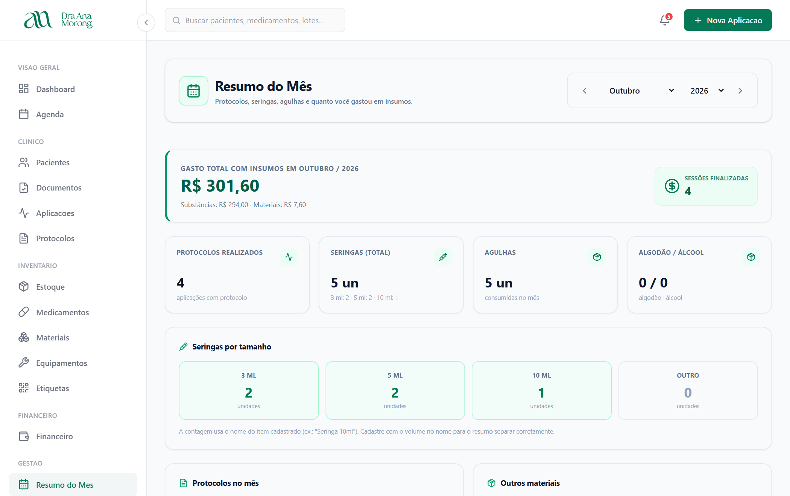

## 12.1 Como Usar a Tela "Resumo do Mês"

Criada especialmente para facilitar a gestão prática do consultório sem precisar somar notas na calculadora:
1. No canto superior direito, escolha o **Mês** e o **Ano** (ex.: *Outubro / 2026*).
2. Veja de imediato o **Gasto Total com Insumos no Mês** separado entre substâncias (vitaminas) e materiais descartáveis, além do total de **Sessões Finalizadas**.
3. Confira o quadro **Seringas por tamanho (3 ML, 5 ML, 10 ML, Outro)** e o total de **Agulhas**: com esses números exatos na tela, você sabe exatamente quantas caixas de cada seringa a clínica consome por mês!

## 12.2 Como Saber Exatamente o Que Comprar (Sugestão de Compras)

Antes de mandar mensagem para os representantes dos laboratórios:
1. Vá em **Estoque** no menu lateral e clique no botão **Sugerir Compras** no topo.
2. O sistema analisa sozinho tudo o que está abaixo do estoque mínimo e o ritmo de consumo recente da clínica, montando uma **lista inteligente de reposição** já agrupada por fornecedor e com estimativa de investimento!

## 12.3 Central de Relatórios (Para Conferência e Contabilidade)

No menu lateral, em **Relatórios** (e em **Financeiro -> Relatórios & Custos**), você pode visualizar na tela ou exportar planilhas prontas para Excel/contabilidade com:
- Extrato completo de atendimentos e faturamento do mês;
- Relatório de lotes que vencem nos próximos 30/60/90 dias;
- Histórico completo de entradas de notas fiscais por fornecedor;
- Rentabilidade detalhada por protocolo clínico e por paciente.

---

# Capítulo 13 - Configurações, Checklists da Recepção e Dúvidas Frequentes

**Onde clicar:** Menu lateral esquerdo (no rodapé da lista) -> **Configurações**.
**Quem usa:** Dra. Ana (configurações da clínica e certificado digital).

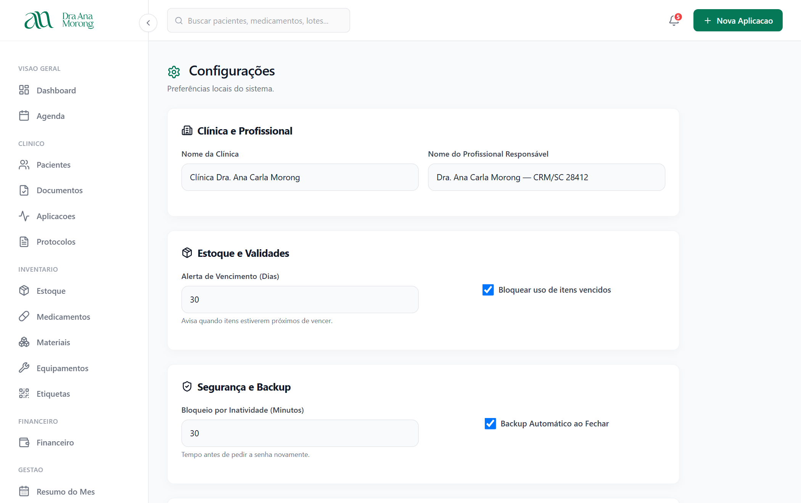

## 13.1 O Que Conferir nas Configurações da Clínica

Na tela de **Configurações**, já deixamos ajustadas as proteções mais importantes do consultório — evite desmarcar sem necessidade:
- **Clínica e Profissional:** Nome oficial da clínica, nome da Dra. Ana, CRM/SC, CNPJ, telefone e endereço (esses dados saem automaticamente no cabeçalho dos contratos, termos e receitas).
- **Alerta de Vencimento (30 dias) e "Bloquear uso de itens vencidos" (SEMPRE MARCADO):** garante que ninguém consiga selecionar acidentalmente uma ampola vencida na Sala de Aplicação.
- **Cofre do Certificado Digital da Dra. Ana (mais abaixo na mesma tela):** guarda com segurança o certificado oficial da doutora para que os contratos assinados pelos pacientes recebam a contra-assinatura médica automaticamente. *Lembrete: certificados digitais vencem a cada 1 ano — quando renovar o certificado com a contabilidade, basta atualizar o arquivo novo ali!*
- **Integração Google (Agenda, Drive e E-mail):** mantém ativa a conexão com a Agenda Google da Dra. Ana e o arquivamento automático dos contratos no Google Drive. Caso apareça algum aviso de falha de envio, clique no botão **Testar Conexão** dentro dessa seção.

---

## 13.2 Checklists Rápidos de Bolso (Para Colar na Recepção)

### Rotina de Abertura da Clínica (5 minutos pela manhã)
- [  ] Entrar no sistema e olhar os alertas do **Dashboard** e do **Sininho** no topo.
- [  ] Abrir a **Agenda** do dia e conferir quem já está com status **Confirmado**.
- [  ] Mandar WhatsApp confirmando a agenda dos pacientes do **dia seguinte**.
- [  ] Verificar se há contratos na aba **Pendentes** aguardando assinatura antes da consulta começar.

### Rotina de Fechamento do Dia (5 minutos antes de ir embora)
- [  ] Na **Agenda**, conferir se todos os pacientes atendidos ficaram como **Realizado** (e se nenhuma sessão ficou esquecida apenas como *Rascunho*).
- [  ] Em **Documentos**, conferir se todos os contratos assinados hoje já estão **Arquivados no Drive**.
- [  ] Em **Financeiro -> Fluxo de Caixa**, conferir se todos os PIX e cartões do dia batem com a maquininha/extrato.
- [  ] Em **Financeiro -> Contas a Pagar**, verificar se algum boleto vence amanhã para deixar programado.

---

## 13.3 Guia Rápido "O Que Fazer Quando..." (Solução das 10 Dúvidas Mais Comuns)

| Situação do Dia a Dia | Como Resolver Rapidamente |
| :--- | :--- |
| **1. Chegou caixa nova de Vitamina B12, mas alguém clicou em "+ Novo Item" em vez de "Entrada de Lote" e duplicou o cadastro.** | Vá em **Estoque**, clique para **Inativar** o cadastro duplicado vazio e faça o lançamento correto pelo botão **Entrada de Lote** no item original. |
| **2. O saldo do medicamento ficou estranho depois de dar entrada na nota.** | Confira se o medicamento está em **mililitros (`ml`)**! Se chegaram 10 ampolas de `2 ml`, o saldo que deve entrar é **`20 ml`** (e o custo unitário é o valor de 1 ml, não da caixa inteira). |
| **3. Uma ampola quebrou na mão na hora de abrir.** | Vá em **Estoque**, clique no ícone de **Ajuste de Saldo** na linha daquele medicamento, diminua `2 ml` (ou o volume da ampola) do lote correspondente e escreva *"Quebra acidental no preparo"*. |
| **4. O sistema não deixa selecionar um lote na Sala de Aplicação.** | Olhe a data de validade daquele lote! Por segurança sanitária, o sistema trava qualquer lote vencido. Separe o frasco vencido para descarte adequado e escolha um lote válido. |
| **5. Finalizei uma aplicação no paciente errado ou com dose errada.** | Vá no menu lateral **Aplicações**, localize o atendimento e clique em **Estornar / Reverter**. Os mililitros e seringas voltam sozinhos para o estoque e você pode lançar o certo! |
| **6. No Contrato Saúde 360®, faltou o endereço ou o CPF da paciente.** | Na própria **Aba 3 (Paciente & Médica)** do Estúdio de Contratos — ou clicando em Editar no **Prontuário** da paciente — preencha o CPF e o endereço completo; a minuta atualiza na mesma hora! |
| **7. O paciente disse que perdeu a mensagem do WhatsApp com o link para assinar.** | Abra o prontuário dele -> aba **Monitorar Contratos** -> clique em **Copiar Link** ou **WhatsApp** e reenvie em 2 segundos (não precisa gerar outro contrato!). |
| **8. O paciente não quer assinar pelo celular dele e está na recepção.** | Você pode abrir o link de assinatura no **tablet da clínica** na frente dele para ele assinar com o dedo na tela ali mesmo no balcão ou consultório! |
| **9. Apareceu erro ao clicar em "Salvar no Drive & E-mail".** | Verifique primeiro se a paciente tem **e-mail válido** cadastrado na ficha dela e se há internet. Se persistir, vá em **Configurações -> Integração Google** e clique em **Testar Conexão**. |
| **10. No Resumo do Mês, as seringas caíram na coluna "Outro" em vez de 3ml / 5ml / 10ml.** | Vá em **Materiais**, clique em editar no nome da seringa e garanta que o tamanho esteja escrito no nome (ex.: *Seringa Descartável 5ml*). O resumo separa na hora! |

---

# Capítulo 14 - Exemplos Práticos do Dia a Dia e Dicionário Simples da Clínica

Para deixar o treinamento de uma nova secretária (ou a consulta rápida na correria) ainda mais fácil, reunimos abaixo **4 situações completas do começo ao fim**, exatamente como acontecem na recepção e no consultório!

## 14.1 Situação 1 — Paciente Nova Fechando o Programa Saúde 360®

1. **Na véspera (Secretária):** Cadastra a paciente em **Pacientes -> + Novo Paciente** com nome completo, CPF, WhatsApp, e-mail e endereço, e marca a consulta na **Agenda**.
2. **Na chegada (Secretária):** Muda o status na **Agenda** para **Confirmado** e pergunta se ela possui alguma alergia a medicamentos ou esparadrapo, anotando em *Observações de alerta*.
3. **Na consulta (Dra. Ana):** Conversa com a paciente, avalia exames e indica, por exemplo, o programa **Saúde 360® Evolution (6 meses)**.
4. **No fechamento na recepção (Secretária):**
   - Abre o prontuário da paciente e clica no botão verde **Contrato Saúde 360®**;
   - Escolhe o plano *Evolution (6 meses)*, marca a forma de pagamento escolhida (*À Vista no PIX* ou *Parcelado no Cartão*) e gera o PDF;
   - Clica em **Enviar por WhatsApp** para a paciente assinar no celular ali mesmo tomando um café;
   - Assim que ficar verde (*Assinado*), clica em **Salvar no Drive & E-mail** e lança o recebimento em **Financeiro -> Contas a Receber**!

## 14.2 Situação 2 — Paciente Vindo Para Sessão Semanal de Injetáveis

1. **Antes da paciente entrar (Secretária):** Na **Agenda**, olha o horário das 10h e clica em **Iniciar Aplicação** (pode salvar como *Rascunho* após conferir na bandeja a ampola do lote sugerido pelo sistema).
2. **No atendimento (Dra. Ana):**
   - Confere na coluna esquerda em qual lado do corpo foi feita a sessão da semana passada para alternar o lado;
   - Clica na região de hoje no **Mapa Corporal** (ex.: *Glúteo Direito*);
   - Confere os mililitros (`ml`), a seringa e o texto da evolução médica;
   - Clica no botão verde **Finalizar & Baixar Estoque**.
3. **Na saída (Secretária):** Confere o pagamento da sessão no **Financeiro** (se ainda não estava quitado dentro de um pacote pré-pago) e já confirma o horário da próxima semana na **Agenda**!

## 14.3 Situação 3 — Entregador Trouxe Caixa da Essentia Pharma ou Victa Lab

1. **Na recepção (Secretária):** Abre a caixa na hora, confere se os frascos estão íntegros e guarda imediatamente na geladeira o que for termolábil (2°C a 8°C).
2. **No computador (Secretária):**
   - Abre o e-mail do laboratório e baixa o arquivo `.xml` da Nota Fiscal;
   - Vai em **Estoque -> Entrada de Lote -> aba Importar XML** e carrega o arquivo;
   - Confere se a quantidade entrou convertida em **`ml`** (ex.: 15 ampolas de 2 ml = `30 ml`), confere o número do lote e a validade impressa na caixinha e marca para gerar o boleto em **Contas a Pagar**;
   - Vai em **Etiquetas**, imprime a etiqueta com QR Code e cola no organizador do armário!

## 14.4 Situação 4 — Fechamento Tranquilo no Último Dia Útil do Mês

1. **Secretária + Dra. Ana:**
   - Abrem **Resumo do Mês** para ver o total de sessões realizadas, o gasto exato em vitaminas e quantas seringas de `3ml`, `5ml` e `10ml` saíram;
   - Abrem **Estoque -> Sugerir Compras** para fazer o pedido único do mês seguinte aos fornecedores;
   - Abrem **Financeiro -> Painel Financeiro** (filtro *Mês atual*) e exportam em **Relatórios** as planilhas de entradas e despesas pagas para enviar à contabilidade!

---

## 14.5 Pequeno Dicionário da Recepção (Traduzindo Palavras do Sistema)

| Palavra na Tela | O Que Significa na Prática (Sem Complicação) |
| :--- | :--- |
| **TCLE** | *Termo de Consentimento Livre e Esclarecido* — documento onde o paciente confirma que foi orientado sobre a aplicação injetável antes de realizá-la. |
| **Arquivo XML** | Arquivo digital da Nota Fiscal enviado por e-mail pelo fornecedor que preenche a entrada de estoque sozinho sem precisar digitar item por item. |
| **Lote Crítico** | Frasco ou material que está vencido ou que vai vencer nos próximos 30 dias e merece atenção imediata. |
| **Salvar Rascunho** | Deixar a tela de aplicação pré-preenchida esperando o atendimento acontecer, **sem** descontar nada do estoque ainda. |
| **Certificado Digital (ICP-Brasil)** | A "identidade digital oficial" da Dra. Ana, com o mesmo valor jurídico de uma assinatura reconhecida em cartório. |
| **Sobra Líquida Insumos** | Quanto sobrou do valor cobrado nos procedimentos depois de descontar o preço de custo das vitaminas, seringas e agulhas usadas. |
| **Ticket Médio** | Valor médio financeiro de cada atendimento realizado pela clínica no período escolhido. |

---

*Manual elaborado especialmente para o dia a dia da **Clínica Dra. Ana Carla Morong** — Florianópolis/SC.*
